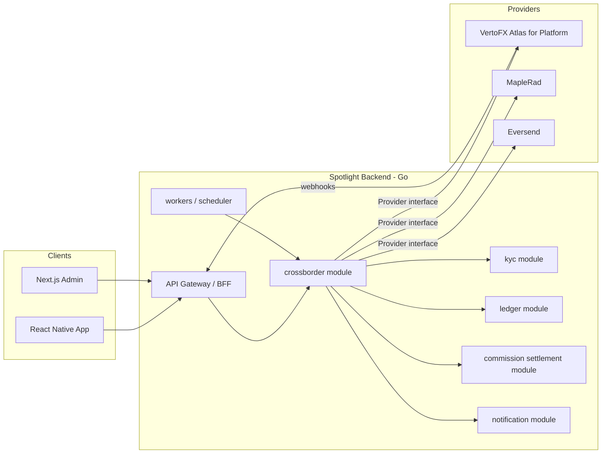
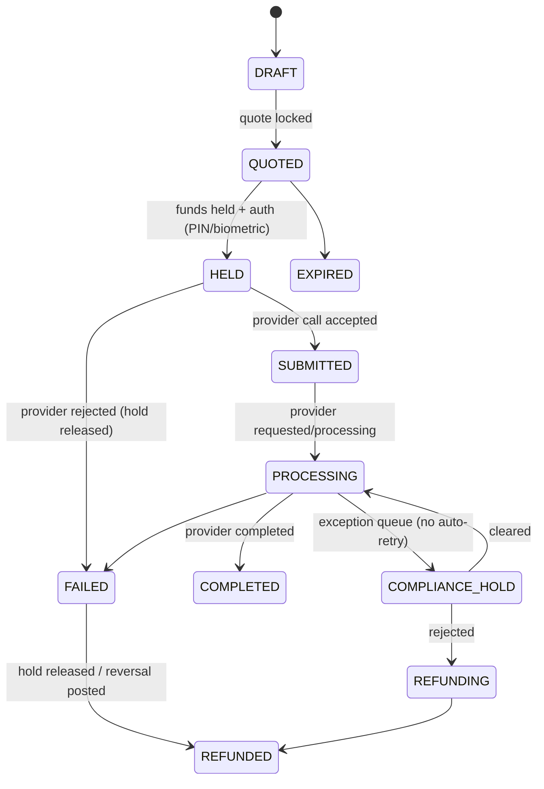

# Spotlight Global — Cross-Border Multi-Currency Platform on VertoFX (Atlas for Platform)

> **Repo-grounding note (added 2026-10-16).** This document is the authored vision spec. It was written without repo access, so every statement about existing code is marked 🧩 and several are now known to be inaccurate (a large FX feature already exists; money is int64 minor units not decimal; there is no transactional outbox; KYC tiers are T0–T3; the commission module, ledger accounts, KYC gateway and provider adapters already exist). **The corrected, code-grounded reality, the decomposition into sub-projects, and the resolved business decisions live in the companion plan: [`docs/superpowers/plans/2026-10-16-vertofx-spotlight-global-program.md`](../plans/2026-10-16-vertofx-spotlight-global-program.md).** Read the plan's "Repo grounding & gap analysis" and "Resolved decisions" sections alongside this spec; where they disagree, the plan wins.

| | |
|---|---|
| **Status** | Draft **v2** for review (design spec, not an implementation plan). v2 adds the Platform Fee model (§7), the full Atlas use-case map (§19), extra use cases (§20), mobile/admin task lists (§21, §22) and the UI alignment plan (§23) |
| **Date** | 2026-10-15 |
| **Stack** | Go (brownfield backend) · React Native (mobile) · Next.js (admin) |
| **Primary provider** | VertoFX, **Atlas for Platform** model (default) |
| **Existing providers** | MapleRad, Eversend (assumed present — *not verified*, see §0 and §25) |
| **Path** | Architectural (new subsystem, touches backend, mobile, admin, ledger, commissions) |

---

## 0. How to read this document

This spec combines three kinds of statements. Each is marked so nobody mistakes an assumption for a fact:

| Marker | Meaning |
|---|---|
| ✅ **Verified** | Read directly from Verto's public documentation (sources in Appendix A) |
| ⚠️ **Verify** | Documentation is silent, ambiguous, or contradicts itself. Must be confirmed with Verto (sandbox test or account manager) before build |
| 🧩 **Assumption** | A design choice or an assumption about your existing system that I could not inspect |

**Important limitation:** the working directory for this session was empty, so I could **not** inspect your Go repo, the React Native app, the Next.js admin, the MapleRad/Eversend integrations, or the commission settlement module. Every statement about existing code is a 🧩 assumption. §24 (Verification Register) lists what must be confirmed with Verto, and §25 contains the questions that remain open, including the repo files I need to replace every 🧩. The design is deliberately built as **ports-and-adapters** so it still holds when the real code differs from my assumptions.

---

## 1. Executive summary

### 1.1 What we are building

**Spotlight Global** is a cross-border money area inside the Spotlight app. It gives users a multi-currency account they can **receive into, convert, hold, and send from** — powered by VertoFX, with Spotlight earning a configurable markup on every transaction and posting that profit into the existing commission settlement module.

Five capabilities, one wallet:

1. **Receive** — local account details in USD / GBP / EUR (and NGN), like a local bank account in each currency.
2. **Convert** — NGN ↔ USD/GBP/EUR and African corridors, with a locked, transparent rate.
3. **Send** — payouts to bank accounts in 190+ countries (Verto's stated coverage).
4. **Hold** — balances in multiple currencies; protect value, convert when ready.
5. **Automate** — rules, alerts, scheduled and recurring transfers, payment links.

### 1.2 Decisions already made (from your answers)

| Decision | Choice |
|---|---|
| Verto integration model | **Atlas for Platform** |
| Existing code visibility | None provided → design is provider-agnostic with explicit integration assumptions |
| Markup model | **FX spread markup** (applied by Verto) **plus a Platform Fee on every Verto-backed service** (charged by Spotlight/Paymax), both configurable per service, corridor, plan and tier (§7) |
| Platform fee *(v2)* | Spotlight/Paymax charges a platform fee on VertoFX services: Receive, Convert, Send, Bulk, Documents, Invoices, and more. Verto's own charges are tracked as cost; profit = revenue − cost. Posted to the commission settlement module (§7.12) |
| Use-case scope *(v2)* | Implement **every Atlas for Platform use case that fits Spotlight** (§19) plus outside-the-box ideas (§20), with mobile (§21) and admin (§22) task lists and an alignment plan for existing UIs (§23) |
| Naming *(assumption)* | "Spotlight/Paymax" is read as one platform (Spotlight app, Paymax as the payments/entity brand). Tell me if they are separate products or entities, because it changes who contracts with Verto and who earns the fee |
| v1 scope | Nigeria-centred NGN↔USD/GBP/EUR · African intra-corridors · multi-currency wallets/accounts · business/creator payouts |
| Default provider | Verto; MapleRad/Eversend retained behind the same interface |

### 1.3 The five things that will make or break this

1. **Individuals on Atlas for Platform are not clearly supported (⚠️ gating).** Verto's onboarding API is entity-shaped (company, shareholders, directors, T&C accepted by a "director"). Docs say Platform supports payouts and collections for individuals in principle, but individual sub-account onboarding is **not explicitly described**. If most Spotlight users are individuals, this is Gate #1. See §6.
2. **The markup is applied by Verto, not by us.** On Atlas for Platform you pass `fxMarkupPerc` and Verto applies it to the trade; your revenue is "paid according to your partnership agreement" with **no documented settlement schedule** (✅ docs, ⚠️ commercial). So FX-spread profit is a **receivable from Verto**, not instant cash. Our **Platform Fee** is ours at execution, but the cash sits in the user's Verto sub-account wallet until swept to our master wallet, which Verto says needs compliance approval on Platform (V5/V18, §7.4). The ledger and the commission module must model both revenue types with different cash timing (§7.11, §7.12, §8).
3. **Each end user must be a Verto sub-account** with Verto-run KYB/KYC (Level 3) and T&C acceptance. This is a compliance requirement, not an implementation choice: using one account to serve third parties breaches Verto's terms (✅).
4. **Rate locks are short** — 30 seconds for instant FX (✅). The UX must make the countdown feel natural, not stressful.
5. **Verto docs contradict themselves in places** (webhook event names, status vocabularies, sub-account scoping). We isolate Verto behind an adapter with a normalizing layer, and keep a **Verification Register** (§24) as a pre-build checklist.

### 1.4 Differentiators (the "outside the box" bets)

- **Auto-convert rules** ("when USD lands, convert 70% to NGN if rate ≥ X").
- **Target-rate orders** and **rate alerts** (our own watcher over Verto's rate API).
- **"Pay me" link/QR page** that gives anyone abroad your USD/GBP/EUR details, branded to Spotlight.
- **Receipts and proof-of-payment** PDFs (visa, school fees, landlord, tax evidence).
- **Send again in 3 taps** with recipient memory and purpose presets.
- **Ambassador revenue share**: referrers earn a slice of the markup via the existing commission module.
- **Business bulk payouts** (CSV → many beneficiaries), payroll-style.
- **Transparent "All-in" pricing** with a tap-to-expand breakdown (platform fee, rate margin, tax) — trust as a feature.
- **Smart Flow Router**: the app picks the right Verto flow (instant, embedded FX payout, inline FX, fund-later, held rate) so users never see the plumbing (§19.3).
- **Invoice-to-cash**, **family allowance**, **school-fees locker**, **split settlement**, **WhatsApp concierge** and more (§20).
- **Plans that lower fees** (Free, Plus, Business, Negotiated) with budgeted promos (§7.10).

---

## 2. What Verto actually offers (grounded in docs)

### 2.1 Integration models ✅

| Model | Who it is for | KYC owner | FX markup | Individuals |
|---|---|---|---|---|
| Corporate / Own funds | Your own business money | Verto standard | No | n/a — **cannot** serve third parties |
| Atlas for Fintech | Licensed FIs with AML audit | **You** (after Downstream Assessment) | **No** | Payouts yes, collections corporates only |
| **Atlas for Platform** | Non-licensed platforms | **Verto**, full KYB/KYC (Level 3) per sub-account | **Yes** | Not explicitly described ⚠️ |

**Why Platform is right for Spotlight:** no financial licence required, FX markup available, G10 currencies available, and it matches the "embedded finance for our users" intent.

### 2.2 Capabilities relevant to us ✅

- **Sub-accounts** per end client, isolated balances/compliance/transactions. Created with `POST /v2/sub-accounts`; status starts **Pending**; becomes **Active** after Verto compliance review and director T&C acceptance. Wallet and IBAN issuance unlocks at approval.
- **Wallets** per sub-account. USD, EUR, GBP, AUD, NGN wallets are created automatically; others (e.g. KES) are created manually with `POST /wallets {"currency": "..."}`.
- **Collections:** local rails (GBP Faster Payments/BACS/CHAPS, EUR SEPA/SEPA Instant, NGN NIBSS/eTranzact) and global (SWIFT). **Dedicated** (unique per wallet) or **pooled** (shared; needs `smartWalletRef` in the payment reference or the payment is auto-returned). NGN supports dedicated details.
- **FX:** instant (30 s lock, debited at booking), fund-later (funding expected within 24 h, detected within ~15 min), held rate (20–30 min hold with +0.2% / +0.3% risk premium), indicative quotes (not bookable).
- **Payouts:** beneficiary → approval → purpose code → payment request. Statuses Requested / Completed / Archived. 190+ countries, 40+ currencies. One NGN example completed in ~39 s (an example, not an SLA).
- **Webhooks:** HTTPS only, ACK `200` within 5 s, dedupe, process asynchronously.
- **Auth:** `POST /users/login` with `clientId` + `apiKey` → bearer token + `companyId`. **Token lasts 60 min; no refresh endpoint — re-login.** Certificate (RSA-encrypted payload) auth is recommended for production.
- **Sandbox:** wallet credit via `POST /v2/simulator/credit`; failures via `X-Verto-Simulation: error_insufficient_funds | error_compliance_hold`.
- **More capabilities (v2):** Global Clearing Flow 1 and Flow 2, Inline FX, Fund Later, mobile-money payouts, name check for NGN payouts, document upload on payouts, sender object, wallet statements, OTC desk. Full list with sources in §19.1.

### 2.3 FX markup mechanics ✅ (critical to the profit model)

- Configured at the **parent** account; applied automatically to sub-account trades.
- **Stateful config:** `POST /fx/markup/config` with `markupType` (`universal` | `currency_pair`) and `markupPerc`.
- **Per-trade override:** `fxMarkup: { markupType, markupPerc }` in Create FX Trade; overrides config for that trade.
- Client rate = Verto base (wholesale) rate adjusted by our margin. The **same** `fxMarkupPerc` shown at quote must be passed at booking so the executed amount equals the displayed amount.
- Reconciliation fields returned: `fxMarkupPerc`, `PRPreFXMarkupRate` (pre-markup Verto rate), `amountFrom`, `amountTo`.
- Must be **enabled by your account manager** before integration.
- ⚠️ Not documented: settlement schedule of markup revenue, caps on markup %, sign convention (direction of adjustment per side of a pair).

### 2.4 Verto base costs

Verto's public US pricing page shows FX margins (0.4–2%), SWIFT payments ($20), and non-USD collections (0.2–0.3%) for US plans, with **payout fees "per your agreement"**. Platform commercial terms for you will differ. ⚠️ **We must obtain Spotlight's own rate card from Verto** and load it into the admin Rate Card (§7). The design never hard-codes Verto prices.

---

## 3. Users, jobs and value

### 3.1 Personas (behavioural, 🧩 to be validated with research)

| Persona | Context | Core job | Pain today |
|---|---|---|---|
| **Diaspora Sender** — Tunde, Houston | Sends to family in Lagos monthly | "Get naira to family fast at a fair rate" | Opaque rates, bank delays |
| **Remote Earner / Creator** — Amara, Lagos | Paid in USD/GBP by foreign clients/platforms | "Receive foreign money locally and cash out at a good rate" | No USD account, parallel-market rate anxiety, lost invoices |
| **SME Importer** — Ibrahim, Kano | Pays suppliers in China/Dubai/UK | "Pay a supplier abroad with proof of payment" | Bank forms, rate surprises, delays |
| **Pan-African Trader** — Wanjiru, Nairobi/Lagos | Trades across KES, NGN, GHS, ZAR | "Move value between African currencies cheaply" | Double conversion via USD |
| **Team Lead / Business** | Pays contractors in many countries | "Pay many people in one go" | Manual repetitive transfers |

### 3.2 Jobs-to-be-done

- When **I get paid in a foreign currency**, I want **local account details I can share instantly**, so I can **get paid without friction**.
- When **I convert money**, I want to **see exactly what I get before committing**, so I can **trust the price**.
- When **I send abroad**, I want **proof it arrived**, so I can **settle obligations (school fees, rent, visa)**.
- When **the rate improves**, I want **the app to act for me**, so I don't **babysit the market**.
- When **my business pays many people**, I want **one upload**, so I can **save hours**.

---

## 4. Feature catalogue and phasing

| # | Feature | Phase | Notes |
|---|---|---|---|
| F1 | Global account activation (KYC + Verto sub-account) | **P1** | Gate for everything |
| F2 | Multi-currency wallets (view, balances, history) | **P1** | NGN/USD/GBP/EUR first |
| F3 | Receive: account details per currency, share/copy | **P1** | Dedicated NGN; local GBP/EUR/USD |
| F4 | Convert with locked rate and transparent fees | **P1** | Instant FX, 30 s lock |
| F5 | Send to bank (beneficiary book, purpose, receipt) | **P1** | Verto payout flow |
| F6 | Activity feed, status timeline, receipts PDF | **P1** | |
| F7 | Admin: pricing/markup console, KYC queue, txn explorer | **P1** | |
| F8 | Commission-module posting of markup and fees | **P1** | Core business goal |
| F9 | Reconciliation and treasury monitoring | **P1** | Non-negotiable for money movement |
| F10 | African corridors (KES, ZAR, TZS, XOF/XAF, GHS where supported) | **P2** | Manual wallet creation for non-default currencies |
| F11 | Rate alerts and target-rate orders | **P2** | Spotlight-side watcher |
| F12 | Pay-me link / QR page | **P2** | |
| F13 | Scheduled and recurring transfers | **P2** | |
| F14 | Auto-convert rules on inbound funds | **P2** | Uses `inbound` webhook |
| F15 | Business bulk payouts (CSV) and approvals | **P3** | Maker-checker for businesses |
| F16 | Held-rate "lock for 30 min" | **P3** | Verto premium 0.2%/0.3% ⚠️ pass-through |
| F17 | Fund-later FX ("lock now, pay within 24 h") | **P3** | Good for diaspora senders |
| F18 | Ambassador revenue share | **P3** | Via commission module |
| F19 | Multi-provider smart routing/failover | **P3** | Verto default, MapleRad/Eversend fallback |
| F20 | Notifications over WhatsApp/SMS/push/email | **P2** | |

> **v2 note:** this catalogue is extended by the full Atlas use-case map **U1–U24 (§19.2)** and the outside-the-box set **X1–X22 (§20)**. Where an F-item and a U-item overlap, the U-item row in §19.2 is authoritative for scope, fee line and phase.

---

## 5. Architecture (Go brownfield)

### 5.1 Principles

1. **Provider isolation.** No Verto types leak outside `providers/verto`. The domain speaks Spotlight language.
2. **Ledger is the source of truth for user balances;** Verto wallets are reconciled against it (§8, §11.3).
3. **Everything money-moving is idempotent, state-machine driven, and auditable.**
4. **Quotes are immutable snapshots.** What the user saw is what we persist and what we execute.
5. **Config over code** for pricing, limits, routing, corridors — all versioned, approved, and effective-dated.
6. **Fail closed** on compliance, **fail soft** on convenience (alerts, analytics).

### 5.2 Context diagram



### 5.3 Module layout (🧩 adapt to your repo conventions)

```
internal/crossborder/
  domain/          # entities, value objects (Money, Corridor, Quote, Transfer), state machines
  app/             # use cases: ActivateAccount, GetQuote, ConfirmConvert, SendMoney, ...
  ports/           # interfaces: Provider*, LedgerPort, CommissionPort, KYCPort, NotifierPort
  pricing/         # rate cards, markup rules engine, quote builder
  routing/         # provider selection, capability matrix, circuit breakers
  providers/
    verto/         # client, auth/token cache, mappers, webhook parser, simulator helpers
    maplerad/      # existing code moved behind the interface (🧩)
    eversend/      # existing code moved behind the interface (🧩)
  webhook/         # ingestion endpoint, verification, dedupe, outbox
  recon/           # reconciliation jobs and break management
  limits/          # velocity/limit checks
  http/            # handlers, DTOs, validation
  store/           # repositories (Postgres 🧩)
```

### 5.4 Provider ports (interface segregation)

Small interfaces so MapleRad/Eversend can implement only what they support, with a **capabilities** descriptor for routing.

```go
type ProviderID string // "verto", "maplerad", "eversend"

type Capabilities struct {
    Accounts     bool
    Collections  []CurrencyRail // e.g. {USD, "ACH"}, {NGN, "NIBSS"}
    FXInstant    bool
    FXHeldRate   bool
    FXMarkup     bool            // provider applies partner markup
    Payouts      []Corridor      // from/to currency + country + rail
    Webhooks     bool
}

type AccountProvider interface {
    CreateAccount(ctx context.Context, in CreateAccountInput) (ProviderAccount, error)
    SubmitOnboarding(ctx context.Context, acct ProviderAccountRef, in OnboardingData) error
    GetAccount(ctx context.Context, acct ProviderAccountRef) (ProviderAccount, error)
}

type WalletProvider interface {
    EnsureWallet(ctx context.Context, acct ProviderAccountRef, ccy Currency) (ProviderWallet, error)
    GetBalance(ctx context.Context, w ProviderWalletRef) (Money, error)
    GetFundingDetails(ctx context.Context, w ProviderWalletRef) ([]FundingDetail, error)
}

type FXProvider interface {
    GetRate(ctx context.Context, in RateInput) (ProviderRate, error) // returns base rate + provider token + expiry
    BookFX(ctx context.Context, in BookFXInput) (FXTrade, error)     // idempotent by PaymentID
}

type PayoutProvider interface {
    CreateBeneficiary(ctx context.Context, acct ProviderAccountRef, in BeneficiaryInput) (ProviderBeneficiary, error)
    GetBeneficiary(ctx context.Context, ref ProviderBeneficiaryRef) (ProviderBeneficiary, error)
    PurposeCodes(ctx context.Context) ([]PurposeCode, error)
    CreatePayout(ctx context.Context, in PayoutInput) (ProviderPayout, error) // idempotent by PaymentID
    GetPayout(ctx context.Context, ref ProviderPayoutRef) (ProviderPayout, error)
}

// v2 additions: Atlas for Platform use cases (§19)
type InlineFXProvider interface {
    // Convert and pay in one call for non-holdable currencies; PaymentMode "immediate" or "later".
    ExchangeAndPayout(ctx context.Context, in ExchangeAndPayoutInput) (ProviderPayout, error) // idempotent by PaymentID
}

type FundLaterProvider interface {
    QuoteLater(ctx context.Context, in RateInput) (ProviderRate, error)   // paymentMode "later", 24h window
    BookPending(ctx context.Context, in BookFXInput) (FXTrade, error)     // executes when funds are detected
}

type DocumentProvider interface {
    GenerateUploadLink(ctx context.Context, in UploadLinkInput) (UploadLink, error) // payout/onboarding documents
    GetStatement(ctx context.Context, w ProviderWalletRef, from, to time.Time) (Statement, error)
}

type NameVerifier interface {
    GetAccountName(ctx context.Context, in AccountLookupInput) (AccountName, error) // NGN local payouts only
}

type TransferProvider interface {
    WalletToWallet(ctx context.Context, in WalletTransferInput) (WalletTransfer, error) // fee sweep, funding, same currency only
}

type EventParser interface {
    ParseWebhook(ctx context.Context, h http.Header, body []byte) ([]NormalizedEvent, error)
}
```

**Normalised events** (provider-agnostic): `account.approved|rejected|suspended`, `collection.requested|completed|returned`, `fx.executed|failed`, `payout.requested|processing|completed|failed|cancelled`, `refund.completed`, `compliance.hold`.

### 5.5 Provider registry and routing

- **Default provider = Verto**, set in config (`crossborder.default_provider`), overridable per corridor, per user cohort, and per feature via feature flags.
- **Routing table** (admin-editable, 🧩 stored in DB):

| Corridor | Primary | Fallback | Condition |
|---|---|---|---|
| NGN↔USD/GBP/EUR | Verto | Eversend/MapleRad (if they support it) | Circuit breaker open / Verto limit hit |
| Intra-Africa (KES, ZAR, TZS, XOF/XAF) | Verto | Eversend (strong in East Africa 🧩) | Currency/rail coverage |
| Payouts to unsupported country | Verto if supported, else fallback | — | Capability check |

- **Circuit breaker + health:** per provider+operation; open on consecutive 5xx/timeouts; admin kill-switch per corridor.
- **Critical rule:** funds sit in **one provider per transfer**. Fallback only applies to **new** transfers; an in-flight transfer never changes provider. Sub-accounts/wallets are provider-specific (a user may have an account at multiple providers; the app shows a unified wallet).

### 5.6 Verto adapter specifics

- **HTTP client:** per-service base URLs (login, wallet, beneficiary, exchange, onboarding hosts differ in sandbox ✅; production hosts ⚠️ from "URLs" page). Timeouts (connect 3 s, read 10 s), retries with jitter only on idempotent reads and on writes carrying a stable `paymentId`.
- **Token manager:** cache bearer token; refresh proactively at ~50 min (token lifetime 60 min ✅); single-flight login to avoid thundering herd; tokens in memory + encrypted shared cache for multi-instance.
- **Production auth:** certificate-based (RSA-encrypted login payload) ✅ recommended; store private material in your secrets manager/HSM (🧩 what you use).
- **Sub-account scoping:** docs show two mechanisms: `companyId` in route paths and an `X-Sub-Account-Id` header ✅/⚠️. Adapter hides this; verify in sandbox which applies to each service.
- **Idempotency:** `paymentId` (UUID) on trades/payouts ✅ in examples; sandbox page confirms same-key retry semantics. We generate `paymentId` = our `transfer_id` UUID.
- **Mappers:** two status vocabularies exist for sub-accounts (Pending/Active/Suspended vs CREATED/APPROVED/REJECTED) ✅ → mapped into one internal enum.
- **Contract tests** against the Verto sandbox in CI nightly; record/replay fixtures for unit tests.

---

## 6. KYC and onboarding ("Global account activation")

### 6.1 Principle

> **Value before verification, gate at the action.** Users can explore rates, see the wallet UI, and read about fees without KYC. We gate at *Activate Global Account* and again at limit upgrades.

### 6.2 Two-layer KYC

| Layer | Owner | Purpose |
|---|---|---|
| **Spotlight KYC** (🧩 existing or to build) | Spotlight | Identity proofing, fraud control, data you must collect anyway (BVN/NIN, selfie liveness, address) |
| **Verto KYB/KYC (Level 3)** ✅ | **Verto** compliance | Required per sub-account; Verto reviews data we submit |

We **pre-collect** everything Verto needs *inside Spotlight's flow* so the user fills one journey, and we submit it to Verto via API.

### 6.3 Activation flow

```mermaid
sequenceDiagram
  participant U as User (RN app)
  participant S as Spotlight API
  participant K as Spotlight KYC
  participant V as Verto
  U->>S: Tap "Activate Global Account"
  S->>K: Check Tier ≥ 2 (ID + selfie + address)
  K-->>S: ok / missing steps
  S->>V: POST /v2/sub-accounts (name, country, identificationNumber, accountType)
  V-->>S: companyId (status PENDING/CREATED)
  S->>V: POST /companies/{companyId}/onboarding-data (products, company/shareholders, docs)
  V-->>S: 200 OK → Review
  Note over V: Verto compliance review (SLA ⚠️ unknown)
  V-->>S: webhook sub-account approved (+ T&C link to nominated director)
  S-->>U: Push: "Accept Verto terms to go live"
  U->>V: Accepts T&Cs (link / in-app webview)
  V-->>S: account Active; wallets + virtual accounts provisioned
  S->>S: Create wallets, fetch funding details, seed ledger accounts
  S-->>U: "Your Global Account is live 🎉"
```

### 6.4 Data collected for Verto ✅ (from the onboarding payload)

- `selectedProducts` (min. 1): **Collect, Convert, Pay, Hold** — we request all four by default; business-only products can be trimmed by user type.
- `company` (type, addresses: COMPANY_ADDRESS / OPERATING_ADDRESS).
- `shareholders`: INDIVIDUAL (name, email, % ownership, nationality, controlling officer flag, role, DOB, phone, address, documents) or CORPORATE (business name, type, registration number, ownership topology, documents). **Full data for any UBO ≥ 25%.**
- `companyDocuments` / shareholder documents: `typeId` + uploaded `link` + `country` (document links generated via Verto's Document Link Generation API; full ID list on Verto's Document Type IDs page ⚠️).
- Risk-assessment answers (Verto "Risk Assessment Question IDs" page ⚠️).

### 6.5 The individual-user problem (Gate #1) ⚠️

Verto's Platform model onboards "clients" with directors and UBOs. A Nigerian creator or diaspora sender is an **individual**. Options, to be resolved with Verto before build:

| Option | Description | Pros | Cons |
|---|---|---|---|
| **A. Individuals as sub-accounts (preferred)** | Verto confirms an individual/sole-prop onboarding path under Platform | Cleanest UX and compliance | Needs written confirmation + API schema for individuals |
| **B. Sole-proprietor-as-business** | Individuals onboarded as a "sole trader/business" with themselves as director + UBO | Works with the documented schema | Extra fields; friction; some users have no business registration |
| **C. Pooled/omnibus ledger-only users** | Spotlight holds funds on master, users are ledger entries | Simplest UX | ❌ **Violates Verto terms** (third parties on own-funds account) — **rejected** |
| **D. Switch to another provider for individuals** | Use Eversend/MapleRad for retail, Verto for business/creator | Fast to ship | Splits the experience; weaker on markup/profit unification |

**Recommendation:** pursue A in the Verto commercial conversation; design the data collection so B is a thin variant. Option D remains the contingency (and is already enabled by the provider abstraction).

### 6.6 Spotlight KYC tiers and limits (🧩 numbers are placeholders for compliance to set)

| Tier | Requirements | Unlocks |
|---|---|---|
| T0 | Phone + email | Browse rates, calculators, waitlist |
| T1 | BVN/NIN match + selfie liveness | Existing Spotlight features (🧩) |
| T2 | Address + government ID + source-of-funds questionnaire | **Apply for Global Account** |
| T3 | Verto-approved sub-account active | Receive, convert, send within base limits |
| T4 | Enhanced due diligence (business docs, proof of income) | Higher limits, bulk payouts |

Limits live in admin config (per tier × corridor × direction × daily/monthly), enforced pre-quote and pre-execution.

### 6.7 Failure and edge handling

- **Rejected by Verto:** show human reasons from a mapped taxonomy; offer **Fix and resubmit** (documents `action: UPDATE`), never a dead end.
- **Suspended:** banner + frozen-funds explanation; support deep link.
- **Stuck in review:** SLA timer in admin; auto-nudge Verto contact after N hours; in-app expectation setting ("usually 1–2 business days" — ⚠️ replace with Verto's real SLA).
- **Data drift:** shareholder/company changes use `action: UPDATE|DELETE` ✅.
- **Consent log:** store T&C acceptance timestamp, IP/device, version.

---

## 7. Pricing, platform fee and profit engine

> **Updated in v2.** Spotlight (Paymax) now charges a **Platform Fee on every Verto-backed service**, in addition to the FX spread markup. Verto's own charges to us are tracked separately as **cost**, so profit is always `revenue − cost`, line by line.

### 7.1 The four price layers

| Layer | Who sets it | Who collects it | What it is |
|---|---|---|---|
| **L0 Verto cost** | Verto (our rate card) | Verto, from us | Verto's FX margin inside the base rate, payout fees, collection fees, SWIFT fees, held-rate premium. Never shown to users as such. ⚠️ Values come from our agreement. |
| **L1 Platform Fee** *(new)* | Spotlight / Paymax | **Spotlight** | Our fee for each service: Receive, Convert, Send, Bulk, Hold, Documents, etc. Flat, percentage, or flat + % with min/max. |
| **L2 FX spread markup** | Spotlight / Paymax | **Verto applies it, then pays us** | Percentage passed as `fxMarkupPerc` / `fxMarkup` on FX trades ✅. Revenue is a receivable (settlement terms ⚠️ V2). |
| **L3 Pass-through and statutory** | Verto / government | Verto or tax authority | Held-rate premium (+0.2% for 20 min, +0.3% for 30 min ✅), VAT on fees, any statutory levies (rates 🧩 confirm with finance/tax advisor). |

```
customer_pays      = amount + L1 platform fee + L3 pass-through + L3 taxes     (+ L2 baked into the rate)
spotlight_revenue  = L1 platform fee + L2 fx spread
spotlight_cost     = L0 verto cost not already inside the Verto rate
spotlight_profit   = spotlight_revenue − spotlight_cost
```

### 7.2 Platform Fee catalogue (one fee line per Verto service)

Every row is a **fee schedule entry** editable in admin (§12). Defaults below are **illustrative placeholders for the business to set**, not recommendations.

| Service (Spotlight name) | Verto capability behind it | Fee basis | Typical payer | Notes |
|---|---|---|---|---|
| **Receive – local** | Virtual account credit (NGN, USD, GBP, EUR, KES…) | % of inbound with min/max, or free on paid plans | Receiver | Charged when credit state = completed (after AML screening ✅) |
| **Receive – international (SWIFT)** | Global account details | Flat + % | Receiver | Recover any Verto SWIFT cost (L0) |
| **Convert – instant** | Get FX Rate + Create FX Trade (30 s lock ✅) | Optional small % / flat **plus** L2 spread | Sender | Spread is the main earner |
| **Convert – lock now, pay later** | Firm Order / Fund Later (24 h ✅) | Flat "lock fee" + spread | Sender | Verto bills unfunded-trade loss to client ✅ → we pass that risk on (§7.9) |
| **Convert – held rate** | Held Rate 20/30 min ✅ | Verto premium pass-through + small lock fee | Sender | Premium is L3, not profit |
| **Send – local bank** | Create Payment Request | Flat + % (min/max) | Sender | Verto payout fee is L0 cost |
| **Send – SWIFT** | Payout via SWIFT | Flat + % | Sender | Verto SWIFT fee is L0 cost ($20 on US public plans, ours differs ⚠️) |
| **Send – convert and pay in one step** | Global Clearing Flow 1 / Exchange & Payout API ✅ | Flat + % + L2 spread | Sender | One quote, one confirm |
| **Send – inline FX (non-holdable currencies)** | Inline FX ✅ (INR, EGP, ETB, GHS, BDT, PKR, IDR listed) | Flat + % + L2 spread | Sender | Only route for those currencies |
| **Send – mobile money** | Mobile-money payout (Kenya, Tanzania listed ✅) | Flat + % | Sender | Verify per-country coverage ⚠️ |
| **Bulk payouts / payroll** | Repeated Create Payment Request / Flow 1 | Per-recipient fee + optional batch fee | Business | Volume tiers |
| **Documents and proof** | Generate Upload Link ✅, wallet statements ✅ | Free or small flat fee | User | Proof-of-payment, statements for visa/banks |
| **Invoice / pay-me link** | Virtual account + our reconciliation | % of invoice paid, with cap | Receiver or payer | Spotlight-built feature |
| **Priority handling** | Support/ops tooling | Flat | Sender | Optional |
| **Refund / return handling** | Refund flows ✅ | Cost recovery only | Per policy (§7.12) | |
| **Wallet plan (subscription)** | n/a | Monthly/annual | User | Lowers per-transaction fees (§7.10) |
| **Card issue/fund/spend** | Verto card modules exist ✅; details unavailable ⚠️ | TBD | User | Phase 3, pending Verto confirmation (V20) |

### 7.3 Fee payer and display modes

- **Fee on top (default for Send):** "You pay 1,000 + fee 4.00. They get exactly 1,000."
- **Fee included:** "You pay 1,000. They get 1,000 minus fee." (useful for Receive)
- **Split:** configurable percentage between sender and receiver (marketplace/creator use cases).
- **Target-amount gross-up:** when the recipient must receive exactly `T` and fee = `flat + p × A` charged on top, the sender pays `S = T + flat + p × T`. When the sender fixes the total `S` they will pay (fee computed on `T`), `T = (S − flat) / (1 + p)`. Both formulas are property-tested and rounding follows §7.6.
- **Display:** one **all-in** line by default, with a tap-to-expand breakdown: *Platform fee · FX rate margin · Provider/lock fee · Tax*. The breakdown always sums exactly to the all-in figure.

### 7.4 How the platform fee is actually collected (decision needed)

The fee is revenue earned by Spotlight, but the user's money sits in a **Verto sub-account wallet**. Moving it to Spotlight needs a mechanism. Four options, ranked:

| Option | How it works | Pros | Cons / gate |
|---|---|---|---|
| **A. Ledger charge + scheduled fee sweep (recommended)** | Fee is debited from the user's balance in **our ledger** at execution. Verto wallet still holds those funds, tracked as `fees_unswept`. A daily job moves accumulated fees from each sub-account wallet to our master wallet with the wallet-to-wallet transfer ✅. | Real-time fee accounting; one place for cash | ⚠️ **V5/V18**: Verto says sweep to parent is *not available by default and needs compliance approval*; also confirm Verto permits partner fee deductions |
| **B. Charge in Spotlight's own NGN wallet** | Fee billed to the user's existing Spotlight NGN wallet, converted at the quote's rate | No Verto dependency; works today | User must hold NGN in Spotlight; poor for diaspora senders |
| **C. Bake into the FX spread** | Larger L2 spread, no visible fee on Convert | Simple, Verto-native | Less transparent; not available for Send/Receive |
| **D. Subscription billing** | Monthly plan charged to card/NGN wallet | Predictable | Doesn't replace per-transaction fees |

**Design:** the ledger and quote engine are written for **A**; the fee collector is a pluggable strategy (`FeeCollector` interface) so B and C are available per corridor on day one if V5/V18 are not approved in time. Reconciliation rule: `Verto sub-account wallet balance = user ledger balance + fees_unswept (+ in-flight holds)`.

### 7.5 Rule model and hierarchy

Each fee or spread rule: `{ id, version, service_type, direction, corridor, rail, currency, user_plan, user_tier, amount_band, fee: {flat, pct_bps, min, max}, fx_spread_bps, payer_mode, valid_from, valid_to, status, maker, checker }`.

Most specific wins:

1. Per-transfer override (support/admin; reason + permission required)
2. Promo / campaign rule (time-boxed, budget-capped)
3. Negotiated business schedule (per business account)
4. Plan × corridor × service × amount band
5. Corridor × service
6. Currency-pair rule (mirrors Verto `currency_pair` ✅)
7. Universal rule (mirrors Verto `universal` ✅)

L2 spread resolution is sent to Verto as `fxMarkup`; the displayed rate and the executed rate must use the **same** percentage ✅.

### 7.6 Guardrails and money rules

- **Never below cost:** a rule is rejected if `fee + spread < L0 cost + floor_margin` for any amount in its band.
- **Hard cap:** total of platform fee + spread must not exceed a configured maximum percentage per transaction (set by management/compliance).
- **Maker-checker, effective dating, instant rollback** for every pricing change.
- **Max step change** per edit (±50 bps default) without a second senior approval.
- **Rounding:** decimals only, never floats. What the user *receives* rounds **down**; what the user *pays* rounds **up**, at the currency's minor unit (Verto "Currency Decimal Support" ✅ page to be mapped ⚠️). Fee computed once per quote and frozen.
- **Pricing simulator** in admin: corridor + service + amount + plan → exact user view and Spotlight profit/margin.
- **Realisation monitor:** alert if realised spread deviates from configured by more than X bps.

### 7.7 Quote construction

A quote is an **immutable snapshot of line items**:

```go
type QuoteLine struct {
    Kind     string          // VERTO_COST | PLATFORM_FEE | FX_SPREAD | PASSTHROUGH | TAX
    Service  string          // receive | convert | send | bulk | docs ...
    Amount   Money
    Payer    string          // sender | receiver | spotlight
    RuleID   uuid.UUID
    Visible  bool            // shown in breakdown (VERTO_COST is internal only)
}

type Quote struct {
    ID                 uuid.UUID
    UserID, AccountID  string
    ProviderID         ProviderID
    Flow               string          // instant | fund_later | held_rate | inline_fx | embedded_fx_payout | two_step
    Corridor           Corridor
    SendAmount         Money           // leaves user's wallet incl. fees on top
    ReceiveAmount      Money
    ProviderRate       decimal.Decimal // PRPreFXMarkupRate (Verto base)
    CustomerRate       decimal.Decimal
    FxSpreadBps        int             // → Verto fxMarkup
    Lines              []QuoteLine
    EstProfit          Profit          // Σ revenue − Σ cost, base currency
    PricingVersion     string
    ProviderToken      string          // vfxToken / quoteId, secret
    ExpiresAt          time.Time       // ≤ provider lock window (30 s default ✅)
}
```

Pipeline: validate user, plan and limits → route flow (§19.3) → provider rate → resolve rules → compute L1/L2/L3 → compute L0 cost and profit → freeze → persist → return DTO.

### 7.8 Worked examples (illustrative numbers only)

**A. Convert USD 1,000 → NGN** (Convert fee 0.30%, min USD 1; spread 1.2%; VAT on fees 7.5% 🧩; Verto base rate ₦1,500)

| Line | Value |
|---|---|
| Platform fee (0.30% × 1,000 = 3.00, above min) | USD 3.00 |
| VAT on fee (7.5%) | USD 0.225 → tax liability, **not profit** |
| Amount converted (1,000 − 3.00 − 0.225) | USD 996.775 |
| Customer rate (1,500 × (1 − 0.012)) | ₦1,482.00 |
| **Customer receives** | **₦1,477,220.55** |
| FX spread revenue (996.775 × 1.2%) | USD 11.96 → receivable from Verto |
| Platform fee revenue | USD 3.00 → earned now, swept later (§7.4 A) |
| Verto cost not in rate | USD 0.00 on this leg (per rate card ⚠️) |
| **Gross profit** | **≈ USD 14.96** |

> ⚠️ Sign convention of Verto's markup on each side of a pair must be confirmed in sandbox using `fxMarkupPerc`, `PRPreFXMarkupRate` and `amountTo` (V3) and locked in a golden test.

**B. Send GBP 200 to a Nigerian bank (embedded FX)** — Send fee £1.00 + 0.40% (= £1.80); spread 1.0%; VAT 7.5% on fee (£0.135); Verto payout fee (cost, illustrative) £0.50.

| Line | Value |
|---|---|
| Platform fee revenue | £1.80 |
| Verto payout fee (cost) | −£0.50 |
| Net fee margin | £1.30 |
| FX spread revenue | 1.0% of amount converted → receivable |
| VAT | £0.135 → tax liability |

**C. Receive USD 5,000 via SWIFT** — Receive fee 0.25% (cap USD 25) = USD 12.50; Verto SWIFT cost (illustrative) USD 6 → margin USD 6.50.

### 7.9 Fund-later and held-rate risk

Verto bills the loss on an unfunded fund-later trade to the client (us) ✅. Therefore:
- Fund-later is offered only to **Tier ≥ 3** users with a clean record, within configured amount limits.
- Option to take a **refundable deposit/collateral** (held in our ledger) for larger locks.
- Expiry job: if funds don't arrive within the window, release the lock, charge the lock fee, and book any Verto-billed loss to a risk reserve account.
- Held-rate premium (0.2%/0.3% ✅) is passed through at cost as L3.

### 7.10 Plans, waivers and loyalty (outside the box)

| Plan | Idea |
|---|---|
| **Free** | Default fee schedule |
| **Plus** (monthly) | Lower send/convert fees, free statements, rate alerts, priority support |
| **Business** | Bulk payouts, team members and approvals, invoice fees capped, accounting exports |
| **Negotiated** | Custom schedule per business, volume-tiered |

Waivers: first N transfers free, referral credits, "fee holiday" promos, loyalty tiers by 90-day volume. Every waiver is a **budgeted rule** with a visible cost line in admin, so marketing spend is measured against profit.

### 7.11 Revenue recognition and ledger treatment

| Item | Earned | Cash arrives | Ledger |
|---|---|---|---|
| Platform fee | At transfer completion (or credit completed) | Via fee sweep (A), NGN wallet (B), or subscription (D) | DR user wallet · CR `revenue:platform_fee:{service}` and DR `fees_unswept` asset · CR sub-account wallet mirror on sweep |
| FX spread | At FX execution | Per Verto agreement ⚠️ V2 | DR `receivable:verto_markup` · CR `revenue:fx_markup` → on Verto settlement DR master wallet · CR receivable |
| Verto costs | At execution | Charged by Verto | DR `expense:provider_fees` · CR provider payable/wallet |
| VAT / levies | With fee | Remitted by finance | CR `tax_payable:vat` (excluded from profit) |
| Held-rate / pass-through | At execution | Verto | Net-zero line items |
| Waived fees | At execution | — | DR `expense:promo_waivers` · CR `revenue:platform_fee` (keeps gross revenue visible) |
| Variance | At reconciliation | — | `revenue:fx_markup_variance` |

> 🧩 Finance confirms account codes, base currency, and VAT/levy treatment.

### 7.12 Commission settlement module integration

Define a **port** so integration with your existing module is a mapping exercise:

```go
type CommissionPort interface {
    Post(ctx context.Context, e CommissionEntry) error     // idempotent by IdempotencyKey
    Reverse(ctx context.Context, ref, reason string) error
    MarkSettled(ctx context.Context, ref string, s Settlement) error
}

type CommissionEntry struct {
    IdempotencyKey string          // "cb:{transfer_id}:{component}:{service}"
    Component      string          // PLATFORM_FEE | FX_SPREAD | PASSTHROUGH_NET (zero profit, audit only)
    Service        string          // receive | convert | send | bulk | docs | invoice ...
    SourceType     string          // "crossborder_transfer" | "crossborder_collection" | "crossborder_invoice"
    SourceID       uuid.UUID
    Currency       Currency
    GrossAmount    decimal.Decimal // revenue
    CostAmount     decimal.Decimal // L0 cost netted
    NetAmount      decimal.Decimal // profit posted
    Status         string          // ACCRUED | SETTLED | REVERSED
    CorridorKey    string
    UserPlan, UserTier string
    FeeRuleID      uuid.UUID
    Provider       ProviderID
    Meta           map[string]any  // rate, spread bps, quote id, provider refs, tax lines
    OccurredAt     time.Time
}
```

Behaviour:
- **One entry per component per service** (e.g. Convert → `PLATFORM_FEE` + `FX_SPREAD`), each idempotent.
- **Status lifecycle:** platform fee `ACCRUED` at completion → `SETTLED` when swept/collected; spread `ACCRUED` → `SETTLED` on Verto payment.
- **Reversal:** provider-failed or refunded transfers reverse all components via outbox. Policy table (admin): *provider failure → refund fee in full; user-entered wrong details → retain fee; compliance rejection → configurable*.
- **Taxes excluded** from `NetAmount`; they post to the tax payable account only.
- **Outbox pattern** keeps ledger and commission consistent across crashes.
- **Reporting:** profit by service, corridor, plan, tier, provider, day; accrued vs settled; waiver cost; variance vs Verto statement.
- **Ambassador revenue share:** optional rule splits a % of `NetAmount` to the referrer using the existing module's payee logic (🧩).

---

## 8. Ledger and wallets

### 8.1 Model

- 🧩 If a wallet/ledger module already exists, **extend it**; otherwise create `crossborder_ledger` with **double-entry** accounts:
  - `user:{id}:wallet:{ccy}` (liability)
  - `user:{id}:hold:{ccy}` (funds reserved while a transfer is in flight)
  - `provider:verto:master:{ccy}` (asset: pre-funding/nostro-like)
  - `provider:verto:sub:{companyId}:{ccy}` (mirror of Verto sub-account wallet)
  - `revenue:platform_fee:{service}:{ccy}`, `revenue:fx_markup:{ccy}`, `receivable:verto_markup`, `expense:provider_fees`
  - `fees_unswept:{companyId}:{ccy}` (platform fees earned but still sitting in the user's Verto wallet until the fee sweep, §7.4), `tax_payable:vat`, `expense:promo_waivers`, `reserve:fund_later_risk`
  - `suspense:unmatched_inbound`
- **Verto wallets hold the actual funds** (sub-account wallets ✅). Our ledger **mirrors** and *explains* them. Daily + event-driven reconciliation compares both.

### 8.2 Principles

- **Hold → execute → settle.** Sending money: place a hold on the user wallet, create/book at Verto, convert hold into debit on completion, release on failure.
- **Inbound:** credit user wallet only on Verto's **completed** state (after AML screening). Show "Pending" on **requested** ✅ (funds reached but not credited).
- **Sweep to parent ⚠️:** docs say sweep is *not* available by default on Platform and needs compliance approval, yet the Collections guide recommends wallet-to-wallet sweep. This affects how markup/fee income and treasury funds reach our master wallet — resolve with Verto.
- **Pooled vs dedicated:** use **dedicated** account details wherever offered (NGN ✅). If pooled is the only option for a currency, the pooled reference (`smartWalletRef`) is **auto-injected into every share/copy UI**; payments without it are returned automatically ✅.

---

## 9. State machines

### 9.1 Global account (provider-normalised)

`NOT_STARTED → SUBMITTED → IN_REVIEW → AWAITING_TNC → ACTIVE` · off-ramps: `REJECTED`, `SUSPENDED` (reversible) · maps Verto Pending/Active/Suspended and CREATED/APPROVED/REJECTED ✅.

### 9.2 Quote

`INDICATIVE → LOCKED → (EXPIRED | CONSUMED | CANCELLED)`; instant-FX lock 30 s ✅; held-rate 20/30 min ✅ (P3).

### 9.3 Transfer (send/convert)



Compliance holds **pause automated retries and enter an exception queue**, never "failed" ✅ (per Verto sandbox guidance).

### 9.4 Collection (inbound)

`REQUESTED (AML screening) → COMPLETED (credited)` | `RETURNED` (pooled reference missing) ✅.

---

## 10. Spotlight backend API (REST, mobile/admin-facing)

All money-moving endpoints require `Idempotency-Key`, bearer auth, device binding, and step-up auth where specified.

| Area | Endpoint | Purpose |
|---|---|---|
| Account | `GET /v1/global/status` | Activation status, tier, limits, next step |
| | `POST /v1/global/activate` | Start activation (creates provider account + submits data) |
| | `PUT /v1/global/onboarding/documents` | Upload/replace docs (generates provider doc links) |
| Wallets | `GET /v1/global/wallets` | Balances per currency |
| | `GET /v1/global/wallets/{ccy}/funding-details` | Account details (dedicated/pooled, share payload) |
| FX | `GET /v1/global/rates?from=&to=` | Indicative rates (cached, with sparkline) |
| | `POST /v1/global/quotes` | Locked quote with full decomposition |
| | `POST /v1/global/conversions` | Execute convert from quote (step-up) |
| Send | `GET/POST /v1/global/beneficiaries` | Recipient book (with provider approval status) |
| | `GET /v1/global/purpose-codes?corridor=` | Purpose list |
| | `POST /v1/global/transfers` | Execute send from quote (step-up) |
| | `GET /v1/global/transfers/{id}` | Status + timeline |
| | `GET /v1/global/transfers/{id}/receipt` | PDF receipt |
| Automation | `POST /v1/global/alerts`, `/rules`, `/schedules` | Rate alerts, auto-convert, recurring |
| Pay-me | `POST /v1/global/pay-links` | Create share link/QR |
| Fees | `GET /v1/global/fees?service=&corridor=` | Public fee schedule for the user's plan (drives "What it costs") |
| | `POST /v1/global/quotes/preview` | Fee/rate preview without locking (calculators) |
| Flows | `POST /v1/global/quotes` with `flow=auto\|instant\|fund_later\|held_rate` | Smart Flow Router decides when `auto` (§19.3) |
| Documents | `POST /v1/global/documents/upload-link` | Pre-signed upload for invoices and proofs |
| | `GET /v1/global/statements?ccy=&from=&to=` | Statements and proof-of-funds |
| Name check | `POST /v1/global/beneficiaries/verify-name` | NGN local account name lookup |
| Bulk | `POST /v1/global/bulk-transfers`, `GET /v1/global/bulk-transfers/{id}` | CSV/API bulk payouts with per-row status |
| Invoices | `POST/GET /v1/global/invoices` | Create, share and reconcile invoices |
| Plans | `GET/POST /v1/global/plan` | Current plan, upgrade/downgrade |
| Refunds | `POST /v1/global/transfers/{id}/return-request` | Dispute or recall assistant |
| Admin | `/admin/v1/global/*` | Pricing, routing, KYC queue, txns, recon, profit (see §12) |
| Webhooks | `POST /webhooks/verto` | Verto events (HTTPS, public) |

**Verto API mapping (Appendix B)** lists which Verto call backs each endpoint and what is ✅ verified vs ⚠️ to verify.

---

## 11. Webhooks, reliability and reconciliation

### 11.1 Webhook ingestion ✅/⚠️

- Public **HTTPS** endpoint ✅. **ACK `200` within 5 s**, then process asynchronously ✅ — handler only: verify → persist raw event → enqueue → 200.
- **Dedupe** on `eventId` (stored with unique index) ✅ (Verto may redeliver).
- **Signature verification & IP allowlist:** ⚠️ not documented on pages we could read. Get the verification scheme from Verto; until then restrict by network (allowlist) and additionally **confirm every event by calling Verto's GET** before applying state changes (belt and braces).
- **Event name mismatch ⚠️:** docs list three vocabularies (`iban_to_wallet / remittance_complete / wallet_to_account`; `funds.received / payment.* / fx.*`; `sub_account_approved / transaction_state_change / inbound_payment`). The `EventParser` maps all known names to normalised events and logs unknown ones; subscription config in the Verto dashboard decides which actually arrive. Verify in sandbox.
- **Ordering:** events may arrive out of order; transitions are **monotonic** (state machine rejects regressions) and each handler re-fetches current provider state when in doubt.

### 11.2 Resilience

- **Transactional outbox** for ledger → commission → notifications.
- **Retries** with exponential backoff + dead-letter queue + admin replay.
- **Polling safety net:** a sweeper polls transfers stuck in `SUBMITTED/PROCESSING` > N min (webhook loss ≠ stuck money).
- **Idempotent consumers** everywhere.

### 11.3 Reconciliation (three-way)

| Check | Frequency | Breaks go to |
|---|---|---|
| Spotlight ledger vs Verto wallet balance (per sub-account & master) | Hourly + EOD | Recon queue (admin) |
| Our transfers vs Verto payments/trades (status & amounts) | Every 15 min for open items; daily for all | Recon queue |
| Expected markup revenue vs Verto-reported markup | Per Verto statement cycle ⚠️ | Finance variance report |
| Commission entries vs ledger revenue accounts | Daily | Finance |

Break types: missing-in-provider, missing-in-ledger, amount mismatch, status mismatch, duplicate. Each has a runbook and an assignee.

---

## 12. Admin portal (Next.js) — "Global Control Tower"

### 12.1 Modules

1. **Overview:** volume, active users, success rate, ETA percentiles, **Profit today/week/month** (accrued vs settled), provider health.
2. **Pricing & Platform Fee Console:** Verto rate cards (cost), **Platform Fee schedule per service**, FX spread rules synced to Verto, plans, promos, maker-checker, effective dating, **pricing simulator**, margin heatmap by corridor, spread-realisation check (config vs actual), fee-collection strategy and sweep settings. Full task list in §22 (A3).
3. **Provider & Routing:** default provider, per-corridor routing, circuit-breaker status, kill-switches, capability matrix, credentials rotation status.
4. **KYC & Global Accounts:** review queue, submission status per sub-account, Verto status, rejection reasons, resubmission tooling, SLA timers.
5. **Transactions Explorer:** search by user/ref/provider ref; timeline; raw provider payloads (redacted); quote snapshot; ledger entries; commission entries; **actions**: retry, cancel (where legal), refund, escalate, replay webhook.
6. **Exceptions queue:** compliance holds, returned inbound payments, stuck items, recon breaks — with SLAs and ownership.
7. **Treasury:** Verto master wallet balances per currency, pre-funding needs forecast, low-balance alerts, funding instructions.
8. **Limits & Risk:** tier limits, velocity rules, country/corridor blocklists, beneficiary cooling-off, fraud flags.
9. **Commission & Profit:** markup/fee income by corridor/tier/provider/ambassador; accrued vs settled; variance; export to finance.
10. **Content & Notifications:** templates (push/SMS/email/WhatsApp), localisation, purpose-code labels.
11. **Audit & Access:** immutable audit log, RBAC (Admin, Finance, Compliance, Support L1/L2, Read-only), 2FA, session policies.

### 12.2 Admin UX principles

- **Dangerous actions are slow** (confirm, reason, second approver). **Safe actions are fast** (keyboard-first, saved filters).
- Every number is **drill-down-able** to a transaction and ledger entries.
- **Explain, don't just show:** the explorer shows "why this price" (rule IDs, versions).
- Dark/light, dense tables, CSV export, accessible contrast.

---

## 13. Mobile UX (React Native)

### 13.1 Design principles

1. **Money clarity:** before any commit show *You send · They get · Fee · Rate · Arrives*. No hidden math.
2. **Calm urgency:** the 30-second rate lock is a gentle ring, not an alarm.
3. **Progressive trust:** show value first; ask for KYC only at the moment of need; explain *why* each step exists.
4. **Fewer taps for repeat actions:** "Send again", saved recipients, remembered purposes.
5. **Never a dead end:** every error offers a next action (retry, contact, fix details).
6. **Low-bandwidth tolerant:** skeletons, cached rates with timestamps, optimistic UI only for non-money state.
7. **Accessible by default:** dynamic type, 4.5:1 contrast, screen-reader labels for amounts/rates, haptics with non-haptic equivalents.

### 13.2 Information architecture

```
Spotlight App
└─ Global (entry from Home card + tab)
   ├─ Hub                 balances carousel, quick actions, rate ticker, activation/limits card, alerts
   ├─ Receive             currency picker → account details → share / pay-me link / QR
   ├─ Convert             from/to, live rate, lock, fee breakdown, confirm
   ├─ Send                amount → recipient → purpose → review → confirm → status → receipt
   ├─ Recipients          saved beneficiaries (approval status, last used, edit)
   ├─ Activity            unified feed, filters, search, receipts
   ├─ Automations         rate alerts, auto-convert rules, scheduled transfers
   └─ Verification & Limits   tier ladder, documents, limit meters
```

### 13.3 Key flows

**A. Activation (first run)**
1. Hub shows a **"Open your Global Account"** hero with 3 benefit lines and a visual of 4 currency cards.
2. Tap → checklist: *Verify identity ✓ · Address · Source of funds · Review by our partner · Accept terms*.
3. Each step ≤ 1 screen, pre-filled from Spotlight profile; save-and-resume.
4. After submit: status screen with honest ETA + push on approval; **T&C acceptance** inside an in-app sheet.
5. Celebration state → "Add money" shortcut.

**B. Receive**
- Currency chips (USD · GBP · EUR · NGN) → a **realistic account card** (name, number, bank/sort/routing/IBAN as applicable, reference rule).
- Actions: **Copy**, **Share as image/PDF**, **Share via WhatsApp**, **Create pay-me link**.
- Contextual guidance: *"Tell the payer to include this reference"* (pooled), *"Usually arrives in minutes (SEPA Instant) or within 1 business day"* — copy tuned per rail.
- Pending inbound shows as *"₦… incoming — screening, usually a few minutes"*.

**C. Convert**
- Big amount input, two currency selectors with swap, **live rate** with last-updated time and sparkline.
- Fee line: **"All-in cost 1.5% · You get ₦1,477,220"** with *See breakdown* (platform fee, rate margin, tax; always sums to the all-in figure). Numbers come from the live quote, not hard-coded.
- Primary CTA **"Lock rate · 30s"** → countdown ring → **Confirm** (biometric/PIN).
- On expiry: auto-refresh with **"Rate changed: ₦1,482.00 → ₦1,481.20. Continue?"** (explicit consent when worse).
- Optional **"Wait for a better rate"** → creates target-rate order (P2).

**D. Send**
1. **Amount:** toggle *You send / They receive*; show both.
2. **Recipient:** saved list or add new (country → bank → account number, with name-verification where the rail supports it 🧩); first-time recipient gets a short "double-check" nudge.
3. **Purpose:** friendly list mapped to Verto `purposeId` (e.g. "School fees", "Family support", "Supplier payment"), last-used preselected.
4. **Review:** rate, fee, total debit, ETA, recipient summary, purpose; lock timer.
5. **Confirm:** biometric/PIN; step-up (OTP) above threshold or for new recipients.
6. **Status timeline:** *Received → Converted → Sent to bank → Delivered* with live updates, share-receipt, **"Send again"**.
7. **Receipt PDF:** reference, rate, fee, parties, timestamps (no internal markup breakdown).

**E. Rate alerts and auto-convert (P2)**
- Pick pair + target + expiry → push. **Rule builder**: *"When USD arrives → convert X% to NGN if rate ≥ Y, else wait up to N days"*, always with a preview and a kill switch.

### 13.4 States users will actually hit (design all of them)

| State | Treatment |
|---|---|
| No KYC yet | Teaser + benefits, "Start verification" |
| Verification pending | Progress tracker, what to expect, safe to leave |
| Rejected | Plain-language reason, **Fix & resubmit** |
| Suspended | Calm banner, funds-safe message, contact CTA |
| Provider outage / corridor paused | Banner "Sending to X is temporarily unavailable"; still allow browsing |
| Rate expired | Refresh dialog with delta |
| Insufficient funds | Show shortfall + **Add money / Convert** |
| Compliance hold | "Taking a little longer — we're doing a standard check" (+ ETA, no jargon, no blame) |
| Failed/refunded | Explain, show refund timing, offer retry |
| Offline | Cached balances with "Last updated" stamp; money actions disabled with reason |

### 13.5 Microcopy (examples — tone: clear, warm, direct)

- Rate lock: *"Rate locked for 0:24 — confirm to get ₦1,477,220."*
- Fee: *"No hidden charges. Our fee is $3.00 and our rate margin is 1.2%. See the full breakdown."* (always rendered from the quote lines; never typed by hand.)
- Compliance hold: *"We're running a routine safety check. This usually clears within a few hours."*
- Reject: *"We couldn't verify your address document. Upload a recent utility bill or bank statement (under 3 months old)."*
- Optional **Naija Pidgin** locale for key flows (🧩 validate with users).

### 13.6 Technical notes (RN)

- State: React Query for server state, small store (Zustand) for flow state; **state machine** (XState) for the send flow so impossible states are unrepresentable.
- Secure storage (Keychain/Keystore), biometric via native libs, **device binding + attestation** for step-up.
- Money formatting via `Intl.NumberFormat` + currency metadata; amounts as **strings/decimals**, never floats.
- Animations (Reanimated) for lock ring and balance transitions; respect "reduce motion".
- Push (FCM/APNs) with deep links to transfer detail; in-app inbox mirrors push.
- Analytics events (see §16) behind a consent-aware wrapper.
- Screen-reader and dynamic-type test matrix in CI (visual regression).

---

## 14. Security, risk and compliance

> ⚠️ This section is design guidance. **Regulatory classification, licensing posture, limits, and reporting duties must be reviewed by Spotlight's compliance counsel** (Nigeria and corridor jurisdictions). Atlas for Platform operates under Verto's licences, which shifts but does not remove Spotlight's obligations (marketing claims, data protection, user conduct, consumer protection).

**Controls**
- **Secrets:** API keys/certificates in a secrets manager; rotation runbook; no secrets in logs or client.
- **Transport:** TLS ≥ 1.2 with certificate validation ✅ (Verto requirement).
- **AuthN/Z:** short-lived tokens; device binding; PIN/biometric for money actions; step-up OTP by risk.
- **Fraud/velocity:** per-user/device/recipient velocity, new-recipient cooling-off for large amounts, geo/device anomaly flags, mule-pattern rules (many-in/one-out).
- **AML:** purpose code and source-of-funds capture; sanctions/PEP screening (Verto performs on sub-accounts ✅; Spotlight also screens beneficiaries 🧩); case management for alerts.
- **Data protection:** PII minimisation, field-level encryption for IDs/addresses, retention policy, DSAR support, access logging (NDPA applicability 🧩 counsel).
- **Audit:** immutable log for admin actions, pricing changes, refunds, overrides.
- **Prohibited activity controls:** corridor/purpose blocklists; do not enable "double nesting" style use cases.
- **Marketing/claims:** do not claim "licensed by Spotlight"; disclose Verto as provider where required (🧩 counsel/Verto brand guidelines).

---

## 15. Observability and operations

- **Metrics:** success rate by corridor/provider, quote→confirm conversion, rate-lock expiry rate, time-to-complete percentiles, webhook lag, recon breaks, token-refresh failures.
- **SLOs (proposed):** 99.9% API availability; ≥ 99% transfers reach terminal state within provider-stated ETA; webhook ACK p99 < 2 s; recon breaks resolved < 1 business day.
- **Alerts:** provider error budget burn, treasury balance below threshold, stuck-transfer sweeper hits, markup variance beyond X bps, unusual refund volume.
- **Runbooks:** provider outage, webhook flood/loss, recon break types, credential compromise, sub-account mass suspension, wrong-pricing rollback.
- **Feature flags & kill switches:** per corridor, per feature, per cohort.
- **Rollout:** internal → staff → 1% → 10% → 50% → 100% by cohort; migrate existing MapleRad/Eversend **only new transfers** (in-flight transfers finish on their original provider).

---

## 16. Telemetry and success metrics (user-outcome)

**North Star:** *Value moved successfully per active user per month* (amount × completed transfers), paired with *Profit per active user*.

| Funnel / KPI | Target (initial, 🧩 to calibrate) |
|---|---|
| Activation start → submit | ≥ 55% |
| Submit → Verto approved | ≥ 85% (depends on Verto review) |
| Approved → first receive/convert/send in 7 days | ≥ 60% |
| Quote → confirm | ≥ 45% |
| Transfer success rate | ≥ 98.5% |
| Support contacts per 100 transfers | ≤ 3 |
| Repeat usage (D30) | ≥ 40% |
| Rate-lock expiry rate | ≤ 15% |

**Events:** `global_activation_started/step_completed/submitted/approved/rejected`, `quote_viewed/locked/expired/confirmed`, `transfer_created/completed/failed`, `receive_details_viewed/shared`, `alert_created/triggered`, `rule_created/fired`, `paylink_created/paid`. Include corridor, provider, tier, quote ID, but **never** raw PII or full amounts in analytics without consent.

**Guardrail metrics:** refund rate, chargeback/return rate on inbound, complaint rate, compliance-hold rate, effective spread vs configured.

---

## 17. Testing strategy

- **Unit/property tests:** money arithmetic, rounding, rule precedence, limit evaluation.
- **Golden tests:** pricing decomposition per corridor (locks the verified Verto sign convention).
- **Contract tests:** adapter vs Verto sandbox nightly; fixtures for CI.
- **Sandbox scenarios:** `POST /v2/simulator/credit` to fund; `X-Verto-Simulation` headers for `error_insufficient_funds` and `error_compliance_hold` ✅; replay duplicate webhooks; delayed/out-of-order events.
- **State-machine tests:** all legal/illegal transitions.
- **E2E (mobile + admin):** activation → receive → convert → send → refund.
- **Chaos/failure:** provider 5xx, timeouts after request sent (idempotency), token expiry mid-flow, DB failover mid-outbox.
- **Security:** pen-test on money endpoints, webhook spoofing attempts, IDOR on transfers/beneficiaries.
- **Reconciliation drills** monthly with injected breaks.

---

## 18. Roadmap

### Phase 0 — Commercial, compliance and discovery (before code)

- Execute **Atlas for Platform** agreement; get **FX markup enabled** by the account manager ✅ prerequisite.
- Obtain: **rate card**, **markup revenue settlement terms**, **individual onboarding path**, sub-account **SLA**, production hosts, webhook signing scheme, sweep policy, limits (FX Limits / Quote Length pages), supported corridors/rails per currency.
- Inspect existing repos and fill §24 and the open questions in §25.
- Compliance counsel review (licensing posture, marketing, limits, data protection).
- **Exit:** all **Gate** items in §24 resolved or consciously accepted.

### Phase 1 — Foundation and MVP corridor (NGN ↔ USD/GBP/EUR)

- Provider interfaces; Verto adapter; webhook ingestion; token manager.
- Ledger extension/creation; outbox; commission port + adapter.
- Pricing engine with **Platform Fee schedule per service**, rate cards, maker-checker, admin pricing console and simulator (§7, A3).
- Fee collection: ledger charge, `fees_unswept` accounting and the daily fee sweep (or NGN-wallet/spread fallback) (§7.4).
- Use cases U1–U6, U14, U15, U23, U24 (§19.2); mobile epics M1–M6, M10.1, M11, M13 and admin epics A1–A9, A11–A12 (P1 rows in §21, §22).
- Align existing wallet, send, transactions, KYC and admin screens per §23.
- Activation flow (KYC mapping + sub-account) and admin KYC queue.
- Wallets, receive details, convert, send, receipts, activity.
- Recon jobs, treasury dashboard, exceptions queue.
- **Exit:** staff + 1% cohort live in production; zero unreconciled breaks for 14 days; sandbox → production parity checklist passed.

### Phase 2 — Breadth and stickiness

- African corridors (KES, ZAR, TZS, XOF/XAF, others per Verto coverage) with manual wallet creation.
- Rate alerts, target-rate orders, recurring/scheduled transfers, auto-convert rules.
- Pay-me links/QR; multi-channel notifications.
- Use cases U7, U10, U11, U13, U17, U18, U20 (§19.2) and X1, X5, X6, X7, X8, X9, X12, X13, X14, X16, X22 (§20); mobile epics M7, M8, M3.4, M5.6–M5.8, M6.3, M10.2, M12.2; admin A3.5, A9.3, A10.3, A11.2.
- **Exit:** D30 repeat ≥ 35%; corridor expansion without code changes beyond config.

### Phase 3 — Scale and moat

- Business bulk payouts and approvals; fund-later FX; held-rate option.
- Use cases U8, U9, U12, U16, U19, U21 (cards, if Verto confirms), U22 (§19.2) and X2, X3, X4, X10, X11, X15, X17, X18, X21 (§20); X19/X20 only after counsel review; mobile epics M9, M12.1, M12.3, M4.4; admin A5.4, A6.5, A8.3.
- Ambassador revenue share; multi-provider smart routing/failover (MapleRad/Eversend) with automated health-based switching.
- Advanced insights (non-advice rate context), accounting exports for businesses.

---

## 19. Atlas for Platform: full use-case implementation map

> Goal: use **everything Atlas for Platform offers** that fits Spotlight, each as a product feature with its own fee line (§7.2), mobile tasks (§21) and admin tasks (§22). Items marked ⚠️ depend on facts Verto's public docs don't show.

### 19.1 Verto capabilities relevant to a Platform (verified)

| Capability | What the docs say | Source page |
|---|---|---|
| Customer segments | Platforms (marketplaces, expense management), fintechs, cross-border payment companies, banks/MFBs, white-label brokers, remittance companies | Atlas overview |
| Virtual sub-accounts | Collect locally in NGN, KES, TZS, AED, XOF, XAF, GHS, RWF, ZAR, DKK, UGX, USD, GBP, EUR | Atlas overview |
| Global clearing | Convert and pay out to 100+ countries in 49+ currencies (USD, EUR, CNH…) | Atlas overview, Global Clearing |
| Last-mile payouts | Instant and mass payouts into Africa via **bank transfer or mobile money** | Atlas overview |
| 24/7 FX execution | Via API | Atlas overview |
| Flow 1: Embedded FX | Convert + pay out in **one call**; quote locks 30 s; states `confirmed → inwardSettlementDone → outwardSettlementDone`, `archived`, `refunded` | Global Clearing Flow 1 |
| Flow 2: FX + Payout | Two steps: fund the payout currency (local funding, platform FX, or FX API), then payout; states `requested/completed/archived/refunded` | Global Clearing Flow 2 |
| Inline FX | Convert + pay in currencies you **don't hold**; mandatory for non-holdable currencies (INR, EGP, ETB, GHS, BDT, PKR, IDR listed); `paymentMode` = `immediate` or `later` | Inline FX |
| Firm Order / Fund Later | Lock rate now, fund within 24 h; detection ~15 min | Firm Order |
| Held Rate | 20–30 min hold, +0.2% / +0.3% premium | FX Quote and Book |
| Indicative quotes | Bulk rates API, not bookable | FX Quote and Book |
| Beneficiary name check | Get Account Name, **NGN local payouts only** | Flow 1/2 |
| Documents on payouts | Generate Upload Link; strongly recommended for high-value/high-risk; may be mandatory | Flow 1/2 |
| Sender object | Required when paying on behalf of an underlying customer, including returns to original sender | Flow 1/2, Inline FX |
| Dedicated vs pooled accounts | Dedicated = auto-allocation; pooled = reference (`smartWalletRef`) required | Collections |
| Sub-account sweep | Wallet-to-wallet transfer, instant, same currency; Platform sweep to parent needs compliance approval | Collections, Choosing a model |
| FX markup | Universal, per currency-pair, or per trade | FX & Markup |
| Statements | `wallet.statement.generated` event | Webhooks (support article) |
| Cards | Card modules and `card.transaction.*` events exist; content unavailable | Cards page, webhooks article ⚠️ |
| Trading desk | Exchange Now for instant market conversion; **OTC via Verto trading desk for larger or bespoke trades** (platform use, no API) | Flow 2 |
| Support | 24/7 support and dedicated account management; regulatory experts across twelve emerging markets | Atlas overview |

### 19.2 Use-case implementation matrix

| ID | Use case (user language) | Verto building blocks | Spotlight implementation | Fee line (§7.2) | Phase |
|---|---|---|---|---|---|
| U1 | **Open a multi-currency account** | Sub-account + auto wallets USD/EUR/GBP/AUD/NGN; manual others | Global Account activation (§6) | Plan / none | P1 |
| U2 | **Get paid like a local** (receive in USD/GBP/EUR/NGN/KES…) | Dedicated virtual accounts; local rails | Receive screen, share card, auto-reference for pooled | Receive – local | P1 |
| U3 | **Get paid internationally** (SWIFT) | Global account details | Same screen, "From abroad" tab | Receive – international | P1 |
| U4 | **Convert instantly** | Get FX Rate + Create FX Trade, `fxMarkup` | Convert flow (§13) | Convert + spread | P1 |
| U5 | **Send abroad in one step** | Global Clearing Flow 1 | Send flow with one quote and one confirm | Send – convert and pay | P1 |
| U6 | **Send from a balance you already hold** | Flow 2 (pre-funded payout) | Send "From wallet" mode; treasury batch jobs | Send – local/SWIFT | P1 |
| U7 | **Send to currencies you can't hold** (INR, EGP, ETB, GHS, BDT, PKR, IDR) | Inline FX | Auto-selected by Smart Flow Router (§19.3); user just picks recipient country | Send – inline FX | P2 |
| U8 | **Lock the rate now, pay later** | Fund Later (24 h) | "Lock for 24 h" option, funding reminders, auto-execute on arrival | Lock fee + spread | P3 |
| U9 | **Hold a rate for 20–30 min** | Held Rate | "Take your time" toggle with premium disclosed | Premium pass-through + lock fee | P3 |
| U10 | **Send money into Africa (bank)** | Last-mile bank payouts | Corridor catalogue and schema-driven recipient forms | Send – local | P2 |
| U11 | **Send to mobile money** | Mobile-money payouts (Kenya, Tanzania listed) | Recipient type "Mobile wallet", phone-number validation | Send – mobile money | P2 ⚠️ |
| U12 | **Pay many people at once** (payroll, vendors, creators) | Repeated payouts / Flow 1; sender object for third parties | CSV/API bulk, approvals, partial-failure handling | Bulk | P3 |
| U13 | **Pay a supplier with invoice proof** | Generate Upload Link, purpose codes | Attach invoice, auto-fill purpose, proof-of-payment PDF | Send + Documents | P2 |
| U14 | **Verify recipient name before sending** | Get Account Name (NGN local) | Name-match chip; mismatch warning | Free | P1 |
| U15 | **Diaspora remittance to family** | Flow 1 + last-mile + Fund Later | "Send home" mode, recipient presets, scheduled support | Send + spread | P1 |
| U16 | **Marketplace / merchant settlement** | Collections + convert + payouts to sellers | Split settlement engine (§20 X3) | Receive + Send + Bulk | P3 |
| U17 | **Refunds and returns to original sender** | Sender object, refund states | One-tap "return funds", original-sender reference | Refund handling | P2 |
| U18 | **Statements and proof of funds** | Wallet statements ✅ | PDF/CSV, bank-ready letter, date range | Documents | P2 |
| U19 | **Large trades via trading desk (OTC)** | Verto OTC desk (no API) | "Request a quote" form, staff-assisted workflow with ticketing | Negotiated | P3 |
| U20 | **White-label FX rate board** | Indicative bulk rates API | Public rate page / widget, rate alerts | Free (acquisition) | P2 |
| U21 | **Cards: virtual card for global spend** | Verto card modules ⚠️ | Pending Verto confirmation of availability under Platform | Card fees TBD | P3 ⚠️ |
| U22 | **Team accounts and approvals** | Sub-account per business; our RBAC | Roles (owner, finance, viewer), maker-checker | Business plan | P3 |
| U23 | **Treasury for Spotlight itself** | Master wallet, Exchange Now, wallet-to-wallet | Admin Treasury module (§12) | n/a | P1 |
| U24 | **Notifications for every money event** | Webhooks (inbound, FX, payout, refund, statement) | Event-to-notification mapping across push/SMS/WhatsApp/email | Free | P1 |

### 19.3 Smart Flow Router (decides which Verto flow serves a request)

```
Input: user, source wallet/currency, target currency/country, amount, user preference (lock/hold), plan
1. Target currency non-holdable?                          → Inline FX (immediate or later)
2. User chose "lock rate now, pay later"?                  → Fund Later (Tier ≥ 3, amount ≤ limit)
3. User chose "hold rate 20/30 min"?                       → Held Rate (+ premium disclosed)
4. Source wallet holds target currency?                    → Flow 2, pay from wallet (no FX)
5. Source ≠ target, both holdable, user wants one confirm? → Flow 1 (Embedded FX)
6. Treasury batch / scheduled payout, pre-funded?          → Flow 2 (convert in advance, pay later)
7. Amount ≥ OTC threshold?                                 → offer OTC desk request alongside instant quote
Fallback: provider routing (§5.5) if Verto doesn't cover the corridor
```

All decisions are logged on the quote (`Flow` field) so support can explain "why this route".

### 19.4 Corridor and currency catalogue

- **Virtual-account (collection) currencies:** NGN, KES, TZS, AED, XOF, XAF, GHS, RWF, ZAR, DKK, UGX, USD, GBP, EUR ✅.
- **Wallets created automatically:** USD, EUR, GBP, AUD, NGN ✅; others via Create Wallet (e.g. KES) ✅.
- **Non-holdable (Inline FX only):** INR, EGP, ETB, GHS, BDT, PKR, IDR ✅ (examples). ⚠️ **GHS appears in both lists** (virtual accounts and non-holdable); verify which applies to which flow.
- **Global clearing:** 49+ currencies, 100+ countries ✅; the exact list per rail is data to be pulled from Verto (V15) and stored as `corridors` config, never hard-coded.
- Admin owns a **Corridor Catalogue** (country, currency, rails, holdable?, collection supported?, payout supported?, mobile money?, min/max, ETA, enabled flag).

---

## 20. Outside-the-box use cases Spotlight can build on the same rails

Each reuses Verto building blocks; none requires Spotlight to hold a licence, but several need **counsel review** (⚠️ regulatory).

| ID | Idea | What the user gets | Verto blocks | Revenue | Phase / caveat |
|---|---|---|---|---|---|
| X1 | **Invoice and Get Paid Abroad** | Create an invoice in USD/GBP/EUR, share a link/PDF; client pays by bank transfer to your dedicated account; auto-reconciled by reference; optional auto-convert to NGN | Virtual accounts + inbound webhook + Convert | Invoice % + convert fee + spread | P2 |
| X2 | **Creator / seller global payouts** | Spotlight brands, event organisers or buyers pay creators/vendors in the creator's preferred currency | Flow 1 / Inline FX + bulk | Bulk + spread | P3 |
| X3 | **Split settlement** | One buyer payment auto-splits to platform, seller, affiliate; each paid in own currency | Collections + convert + payouts (our split rules) | Platform % + spread | P3 |
| X4 | **School fees / tuition locker** | Lock today's rate (Fund Later), pay installments before the deadline, proof of payment for the school | Fund Later, documents | Lock fee + spread | P3 |
| X5 | **Family allowance** | Diaspora sponsor sets monthly support per relative; recipient gets naira; sponsor sees receipts and approves exceptions | Scheduled Flow 1 | Send + spread | P2 |
| X6 | **Auto-convert on arrival** | Rules: "When USD lands convert 70% to NGN if rate ≥ X, else wait up to N days" | Inbound webhook + Convert | Convert + spread | P2 |
| X7 | **Dollar-cost averaging into a foreign-currency wallet** | Weekly small conversions into USD/GBP to hold value (not investment advice; copy reviewed by counsel) | Scheduled Convert | Convert + spread | P2 ⚠️ copy/regulatory |
| X8 | **Target-rate orders** | "Convert ₦ to USD when rate reaches X" | Our rate watcher + Convert | Convert + spread | P2 |
| X9 | **Pan-African trader mode** | Direct KES↔NGN↔GHS↔ZAR paths shown cheaper vs routing through USD; saved baskets | Convert + payouts | Convert + spread | P2 |
| X10 | **"Pay with Spotlight Global" checkout for foreign buyers** | Foreign payer pays in their currency to a merchant's dedicated account/link; merchant receives NGN | Virtual accounts + Inline/Convert | Receive + convert + spread | P3 |
| X11 | **Supplier network** | Directory of saved suppliers with terms, invoice upload, recurring orders, rate lock to invoice date | Flow 1, documents, Fund Later | Send + docs + spread | P3 |
| X12 | **Proof-of-funds / visa pack** | Date-ranged statements, bank-ready letter, transaction proofs | Statements | Documents | P2 |
| X13 | **Smart purpose-of-payment assistant** | Suggests the purpose code from the user's description; user confirms (reduces rejections) | Purpose codes API | Free (conversion lifter) | P2 |
| X14 | **Compare vs bank** | Honest, dated, sourced benchmark widget; hidden if not provable | Our data | Acquisition | P2 ⚠️ marketing claims |
| X15 | **Ambassador accounts** | Agents/influencers earn markup share in USD or NGN, withdraw anywhere | Commission module + payouts | Share of profit (cost) | P3 |
| X16 | **WhatsApp concierge** | Rates, receive details, transfer status, repeat last send, with step-up in app for money moves | Webhooks + quotes | Retention | P2 |
| X17 | **Low-data / USSD-lite mode** | Rates, balance and status via light flows for patchy networks | Same APIs | Reach | P3 |
| X18 | **Business auto-sweep** | Threshold rule: keep USD balance ≤ X, convert excess to NGN nightly | Scheduled Convert | Convert + spread | P3 |
| X19 | **Escrow-style trade holds** | Hold buyer funds until delivery confirmation, then release | Our ledger holds + payouts | Escrow fee | P3 ⚠️ **high regulatory sensitivity**, counsel first |
| X20 | **Savings circles in multiple currencies** (ajo/esusu) | Group contribution and payout schedule | Collections + payouts | Group fee | Explore only ⚠️ regulatory |
| X21 | **Corridor intelligence** | "Best day/time to convert" charts using historical rate data (informational, no advice) | Our rate history | Engagement | P3 |
| X22 | **Dispute and recall assistant** | Guided "wrong recipient / not received" flow with auto-evidence pack to Verto support | Refund, RFI flows ✅ | Cost saver | P2 |

---

## 21. Mobile app (React Native) task breakdown

> 🧩 Existing screens are assumptions until repo access is provided; each epic lists **new** work and **update to existing** work.
> Definition of done for every task: design-token compliant, accessible (screen reader, dynamic type, 4.5:1 contrast), all states built (loading, empty, error, offline), analytics events fired, QA-passed on low-end Android and small iPhone.

| ID | Epic / task | Acceptance (short) | Phase |
|---|---|---|---|
| **M1 Foundation** | | | |
| M1.1 | Money component library: `MoneyText`, `AmountInput` (string decimals, currency metadata), `RateChip`, `FeeBreakdown`, `CountdownRing`, `StatusTimeline`, `CurrencyFlag` | Unit + visual regression tests; never uses float | P1 |
| M1.2 | Global module navigation (tab or Home card), deep links, feature flags | Flag-off hides entry; deep link opens transfer detail | P1 |
| M1.3 | API client with idempotency keys, retry/backoff, token refresh, offline queue for non-money actions | Same idempotency key reused on retry | P1 |
| M1.4 | Secure storage, device binding, biometric/PIN step-up service | Money endpoints refuse without fresh step-up | P1 |
| M1.5 | Corridor/metadata cache (currencies, countries, rails, purpose codes) | Works offline for last-known catalogue with timestamp | P1 |
| **M2 Activation and KYC** | | | |
| M2.1 | Activation hero + checklist; resume from any step | Progress persists across sessions | P1 |
| M2.2 | Reuse existing KYC capture (BVN/NIN, selfie, ID, address) with prefill; add source-of-funds and purpose questions | No duplicate questions already answered | P1 |
| M2.3 | Document upload to Spotlight→Verto document link flow, with quality hints | Client-side blur/size checks | P1 |
| M2.4 | Status screens: in review, rejected (fix and resubmit), suspended, T&C pending | Plain-language reasons mapped from taxonomy | P1 |
| M2.5 | In-app Verto T&C acceptance sheet + consent log | Records version, time, device | P1 |
| M2.6 | Business onboarding variant (company, directors, UBO ≥ 25%, documents) | Add/remove shareholders with `ADD/UPDATE/DELETE` semantics | P2 |
| **M3 Wallets and Receive** | | | |
| M3.1 | Wallet hub: currency cards carousel, total value in preferred currency, quick actions | Balances refresh on pull + webhook push | P1 |
| M3.2 | Account-details cards per currency: copy, share image/PDF/WhatsApp | Reference rule shown prominently for pooled accounts | P1 |
| M3.3 | Rail-aware guidance ("SEPA Instant: minutes", "NIBSS: instant") | Copy driven by corridor catalogue | P1 |
| M3.4 | Add currency (create wallet) flow for KES, GHS, ZAR, etc. | Eligibility flags respected | P2 |
| M3.5 | Incoming-funds states: requested/screening → credited, with push | Pending shown but not spendable | P1 |
| **M4 Convert** | | | |
| M4.1 | Convert screen: amount, swap, live rate, last-updated, sparkline | Works with cached rate when offline (disabled confirm) | P1 |
| M4.2 | Lock-rate flow with 30 s countdown, refresh-with-delta consent | If worse, requires explicit tap | P1 |
| M4.3 | Fee breakdown sheet (platform fee, rate margin, tax, total) | Sums exactly to all-in figure | P1 |
| M4.4 | Fund-later and held-rate options with plain explanations | Premium and deadline shown before confirm | P3 |
| **M5 Send** | | | |
| M5.1 | Send wizard: amount → recipient → purpose → review → confirm → status | State machine; cannot reach invalid states | P1 |
| M5.2 | Schema-driven recipient forms from corridor metadata (bank code, sort code, IBAN, mobile number…) | New country needs config only, no app release | P1 |
| M5.3 | Recipient book: approval status chip, last used, edit, delete, favourites | "Pending approval" blocks send with guidance | P1 |
| M5.4 | Name verification chip (NGN local) and mismatch warning | Mismatch needs extra confirm | P1 |
| M5.5 | Purpose picker with smart suggestion + last used | Maps to Verto `purposeId` | P1 |
| M5.6 | Invoice/document attach (camera, gallery, PDF) for high-value or flagged corridors | Upload progress, retry | P2 |
| M5.7 | Mobile-money recipient type | Phone validation per country | P2 |
| M5.8 | Inline-FX corridors (non-holdable currencies): hide complexity, show "converted for you" | Router picks flow automatically | P2 |
| M5.9 | Status timeline (received → converted → sent → delivered), push, share receipt, "Send again" | Timeline matches Verto states mapping (§23.3) | P1 |
| M5.10 | Compliance-hold and failure UX with ETA and next actions | No jargon, no blame | P1 |
| **M6 Activity and documents** | | | |
| M6.1 | Unified activity feed with filters (currency, type, status, date), search | Pagination, offline cache | P1 |
| M6.2 | Receipt PDF and proof-of-payment share | Excludes internal margins | P1 |
| M6.3 | Statements and proof-of-funds generator | Date range, letterhead | P2 |
| **M7 Automations** | | | |
| M7.1 | Rate alerts and target-rate orders | Push on trigger; expiry handling | P2 |
| M7.2 | Auto-convert rules builder with preview and kill-switch | Shows worked example before saving | P2 |
| M7.3 | Scheduled and recurring transfers (family allowance) | Reminder before run; skip/pause | P2 |
| **M8 Pay-me and invoices** | | | |
| M8.1 | Pay-me link/QR with currency selection | Shareable web page | P2 |
| M8.2 | Invoice builder, PDF, status (sent/paid/overdue), auto-reconcile | Matches inbound by reference | P2 |
| **M9 Business features** | | | |
| M9.1 | Team members and roles | Owner/finance/viewer enforced | P3 |
| M9.2 | Bulk payout: CSV import, validation report, approvals, per-row status | Partial failure handling | P3 |
| M9.3 | Supplier directory and recurring orders | | P3 |
| **M10 Plans and fees** | | | |
| M10.1 | Fee schedule screen ("What it costs") per service, plan comparison, upgrade flow | Pulled from live fee config, never hard-coded | P1 |
| M10.2 | Upgrade/downgrade plan, billing history, promo codes | | P2 |
| **M11 Settings, support, safety** | | | |
| M11.1 | Limits and tier ladder with usage meters | | P1 |
| M11.2 | In-app help: contextual FAQ, chat/ticket with transaction attached | One-tap "Report a problem" on a transfer | P1 |
| M11.3 | Security: PIN, biometrics, trusted devices, activity log | | P1 |
| M11.4 | Notification preferences per channel and event | | P1 |
| **M12 Growth and engagement** | | | |
| M12.1 | Referral and ambassador screens | | P3 |
| M12.2 | Rate board and corridor explorer (pre-activation) | Works at Tier 0 | P2 |
| M12.3 | WhatsApp/USSD-lite deep links | | P3 |
| **M13 Quality** | | | |
| M13.1 | E2E suites (Detox/Maestro) for activation, receive, convert, send, refund | CI gate on release branches | P1 |
| M13.2 | Accessibility audit (WCAG 2.2 AA) and localisation QA | | P1 |
| M13.3 | Performance budget (cold start, list render) on low-end Android | | P1 |
| M13.4 | Analytics event schema and consent wrapper (§16) | | P1 |

---

## 22. Admin portal (Next.js) UI/UX task breakdown

| ID | Epic / task | Acceptance (short) | Phase |
|---|---|---|---|
| **A1 Foundation** | | | |
| A1.1 | Global module shell: nav, RBAC permissions, audit logging on every action | Roles: Admin, Finance, Compliance, Support L1/L2, Read-only | P1 |
| A1.2 | Design system extension: data tables, status chips, money cells, JSON viewer (redacted), diff viewer | Shared with existing admin | P1 |
| A1.3 | Global search (user, phone, email, transfer ID, Verto ref, `companyId`) | Results in < 1 s | P1 |
| **A2 Dashboard** | | | |
| A2.1 | KPIs: volume, success rate, ETA percentiles, active users, funnel | Date range, corridor, provider filters | P1 |
| A2.2 | **Profit panel**: platform fee vs FX spread, accrued vs settled, waivers cost | Drill to ledger lines | P1 |
| A2.3 | Provider health tiles + incident banner control | | P1 |
| **A3 Pricing and Platform Fee console** | | | |
| A3.1 | Rate Card editor (Verto costs per corridor/rail), document attachment, validity | "Unknown cost" blocks go-live | P1 |
| A3.2 | **Platform Fee schedule** editor by service × corridor × plan × tier × amount band | Maker-checker, effective dating | P1 |
| A3.3 | FX spread / markup rules (universal, per pair, per trade override) with sync status to Verto `/fx/markup/config` | Shows last sync, diff vs Verto | P1 |
| A3.4 | Pricing simulator and margin heatmap | Matches production quote engine byte-for-byte | P1 |
| A3.5 | Plans and promos manager (budgets, caps, auto-expiry) | | P2 |
| A3.6 | Fee collection settings (strategy A/B/C/D, sweep schedule, thresholds) | | P1 |
| A3.7 | Refund-fee policy table | | P1 |
| **A4 KYC and accounts** | | | |
| A4.1 | Review queue with SLA timers, assignee, filters | Shows Verto status and our checks | P1 |
| A4.2 | Submission viewer: data and documents sent to Verto, resubmit tools | `ADD/UPDATE/DELETE` actions | P1 |
| A4.3 | Rejection reason taxonomy editor (user-facing copy) | | P1 |
| A4.4 | Suspended-account handling and unfreeze workflow | | P1 |
| **A5 Transactions** | | | |
| A5.1 | Explorer with timeline, quote snapshot, ledger lines, commission lines, raw provider payloads (redacted) | "Why this price" panel | P1 |
| A5.2 | Actions: retry, cancel (where legal), refund, escalate, replay webhook, add RFI documents | Reason + second approver for money-affecting actions | P1 |
| A5.3 | Exceptions queue: compliance holds, returned inbound, stuck items | Ownership and SLA | P1 |
| A5.4 | Bulk operations view and partial-failure resolution | | P3 |
| **A6 Treasury and reconciliation** | | | |
| A6.1 | Master wallet balances per currency, forecast, low-balance alerts, funding instructions | | P1 |
| A6.2 | Fee sweep monitor (unswept fees by sub-account, run history, failures) | | P1 |
| A6.3 | Recon dashboard and break management with runbooks | | P1 |
| A6.4 | Markup receivable tracker vs Verto statements | Variance report | P1 |
| A6.5 | OTC desk requests queue (U19) | | P3 |
| **A7 Providers and routing** | | | |
| A7.1 | Provider registry: Verto default; MapleRad, Eversend fallback; capability matrix | | P1 |
| A7.2 | Corridor Catalogue editor (§19.4) with enable/disable and limits | | P1 |
| A7.3 | Flow router rules and kill switches per corridor | | P1 |
| A7.4 | Credentials and webhook subscription status, certificate expiry alerts | | P1 |
| **A8 Risk and limits** | | | |
| A8.1 | Limits by tier × corridor × direction | | P1 |
| A8.2 | Velocity rules, blocklists (country, purpose, recipient), cooling-off settings | | P1 |
| A8.3 | Fund-later eligibility and collateral settings | | P3 |
| **A9 Commission and finance** | | | |
| A9.1 | Commission & profit reports by service/corridor/plan/provider/ambassador | Export CSV/XLSX | P1 |
| A9.2 | Accrued vs settled ledger and settlement batches | Integrates with existing settlement module | P1 |
| A9.3 | Tax lines (VAT/levies) report, fee invoices for businesses | 🧩 tax rules by finance | P2 |
| **A10 Content and customer comms** | | | |
| A10.1 | Notification templates and localisation | | P1 |
| A10.2 | Purpose-code labels and help content CMS | | P1 |
| A10.3 | Status page / incident messaging tool | | P2 |
| **A11 Support tooling** | | | |
| A11.1 | Customer 360 (profile, accounts, transfers, tickets) with safe impersonation view (read-only) | | P1 |
| A11.2 | Macros and guided resolution for top issues (wrong recipient, not received, rate dispute) | | P2 |
| **A12 Quality and governance** | | | |
| A12.1 | Audit log viewer and export | Immutable | P1 |
| A12.2 | Access reviews, 2FA enforcement, session policies | | P1 |
| A12.3 | Admin accessibility and usability testing | | P1 |

---

## 23. Aligning the existing mobile and admin interfaces with VertoFX

> You asked to update the **existing** interfaces to match VertoFX. Without repo access I can't list exact files, so this section defines **what must change in any current wallet/transfer/KYC/admin UI** and how to migrate safely. 🧩 Replace generic screen names with real ones once the code is shared.

### 23.1 Principles

1. **One experience, many providers.** Screens never say MapleRad/Eversend/Verto in their logic; a small provider chip appears only where it helps (support, receipts).
2. **Verto's data model drives the UI model:** account → wallets → funding details; beneficiaries with approval status; quotes with expiry; purpose of payment; documents; sender object.
3. **Server-driven forms** for recipient and KYC fields (per country/currency), so providers' differing requirements don't create app releases.
4. **Strangler migration:** new Global module first, then re-point legacy screens one by one behind flags.

### 23.2 Surface-by-surface alignment (🧩 names are placeholders)

| Existing surface | Change |
|---|---|
| **Home / wallet balance** | Multi-currency balance strip; Global account card with activation state; keep NGN primary |
| **Add money / Fund wallet** | New "Receive" with per-currency account details (dedicated vs pooled reference rule) |
| **Send money / Transfer** | New wizard with locked quote, recipient approval status, purpose of payment, documents, sender info for business |
| **Beneficiaries** | Add provider approval status (Requested/Pending/Approved), country-specific fields, name-match result |
| **Transactions list/detail** | Unified feed; detail shows Verto-mapped timeline, rate, fee breakdown, receipt, "Report a problem" |
| **KYC screens** | Add source-of-funds, address, business/UBO capture, document upload to Verto links, status states from Verto |
| **Rates / calculator** | Backed by Verto indicative rates; explicit "locked vs indicative" language |
| **Settings** | Limits meter, plan & fees page, notification preferences |
| **Admin: Providers/Integrations** | Verto added as default; capability matrix; routing and kill switches |
| **Admin: Users/KYC** | Verto sub-account status, submission data, rejection reasons |
| **Admin: Transactions** | Provider refs, raw payload viewer, replay webhook, refund |
| **Admin: Commissions/Settlement** | New components: Platform Fee and FX Spread; accrued vs settled; variance |
| **Admin: Settings/Fees** | Replaced by Pricing & Platform Fee console (A3) |

### 23.3 Status vocabulary mapping (single source of truth for UI)

| Spotlight state | Verto source (✅ from docs) | User-facing label |
|---|---|---|
| `ACCOUNT_IN_REVIEW` | Sub-account Pending / CREATED→onboarding submitted | "We're reviewing your details" |
| `ACCOUNT_AWAITING_TNC` | Approved, T&C link sent to director | "Accept terms to finish" |
| `ACCOUNT_ACTIVE` | Active / APPROVED | "Your Global Account is live" |
| `ACCOUNT_SUSPENDED` | Suspended | "Account on hold" |
| `ACCOUNT_REJECTED` | REJECTED | "We need more information" |
| `BENEFICIARY_PENDING` | Requested / Pending | "Checking recipient" |
| `BENEFICIARY_APPROVED` | Approved | "Ready to receive" |
| `QUOTE_LOCKED` | quote/`vfxToken` valid (30 s default) | "Rate locked" |
| `TRANSFER_AWAITING_FUNDS` | `inward_remittance_pending` (post-funded) | "Waiting for your funds" |
| `TRANSFER_PROCESSING` | `confirmed`, `inward_remittance_confirmed`, `inwardSettlementDone`, payment `requested` | "On its way" |
| `TRANSFER_COMPLETED` | `outwardSettlementDone`, `outward_remittance_complete`, payment `completed` | "Delivered" (note: `completed` = sent out, not proof of receipt ✅) |
| `TRANSFER_FAILED_REFUNDED` | `archived`, `refunded` | "Returned to your wallet" |
| `TRANSFER_COMPLIANCE_HOLD` | held for review / RFI | "Taking a little longer" |
| `INBOUND_SCREENING` | collection `Requested` | "Funds received, checking" |
| `INBOUND_CREDITED` | collection `Completed` | "Added to your wallet" |

> `archived` covers both cancellations and outward failures ✅ → admin sees a "cause unknown, ask Verto" badge until the account manager clarifies (V7).

### 23.4 Migration and cutover plan

1. **Ship Global module dark** behind flags; staff-only.
2. **Introduce shared components** (money, status, fee breakdown) into existing screens first (no behaviour change).
3. **Flip default provider = Verto** for *new* Global activations; existing MapleRad/Eversend users keep working.
4. **Offer "Upgrade to Global Account"** to existing users; reuse their KYC data to avoid re-entry (subject to Verto compliance acceptance ⚠️).
5. **Unified wallet view** shows legacy and Verto balances with provider chips until retirement.
6. **Re-point legacy send/receive screens** corridor by corridor to the Smart Flow Router; keep legacy as fallback via routing table.
7. **Decommission rules:** a legacy provider path is retired only when volume is zero for 30 days, funds fully reconciled, and support has signed off.

### 23.5 UX consistency checklist (used in design QA)

- Same terms everywhere: *Recipient, Locked rate, Purpose of payment, Account details, All-in fee*.
- Every money screen shows **You send · They get · Fee · Rate · Arrives**.
- Every status has: label, explanation, next action, ETA when known.
- Every list has loading, empty, error and offline states.
- Every irreversible action has biometric/PIN step-up and a clear confirmation.

---

## 24. Verification Register (Gate items are pre-build)

| # | Item | Why it matters | How to resolve | Gate? |
|---|---|---|---|---|
| V1 | **Individual onboarding path under Atlas for Platform** | Determines whether retail users are possible | Written confirmation + schema from Verto | **Gate** |
| V2 | **Markup revenue settlement** (timing, method, currency, statement) | Defines accrual vs cash, commission module states | Partnership agreement / account manager | **Gate** |
| V3 | **Markup sign convention** and permitted ranges/caps | Pricing correctness | Sandbox + docs/agreement | **Gate** |
| V4 | **Spotlight rate card** (FX margin, payout/collection fees per corridor) | Floor margins, profit reporting | Commercial agreement | **Gate** |
| V5 | **Sweep to parent** availability | Treasury/profit flows | Verto compliance approval | **Gate** |
| V6 | Webhook **signature scheme**, retry policy, IPs | Security | Verto docs/support | High |
| V7 | **Event names/payloads** (3 conflicting vocabularies) | Adapter correctness | Sandbox subscription test | High |
| V8 | Sub-account scoping: `companyId` in path vs `X-Sub-Account-Id` header per service | Adapter correctness | Sandbox | High |
| V9 | **Production base URLs** and certificate auth setup | Go-live | Verto "URLs" and cert pages | High |
| V10 | Sub-account **review SLA** and rejection reason taxonomy | UX copy and ops | Verto | Medium |
| V11 | Document **type IDs** and **risk-assessment question IDs** | Onboarding form mapping | Verto reference pages | Medium |
| V12 | **FX limits** and **quote length** guides | Limit config, UX | Verto docs | Medium |
| V13 | Per-currency **beneficiary field formats** (NGN/KES/EUR bank codes), name verification support | Send flow forms | Sandbox | Medium |
| V14 | Production **settlement times/cut-offs** per rail | ETA copy | Verto / measured in pilot | Medium |
| V15 | Supported **countries/currencies list** for payouts and collections | Corridor catalogue | Verto | Medium |
| V16 | Idempotency semantics beyond `paymentId` (headers? TTL?) | Safe retries | Verto docs / sandbox | Medium |
| V17 | Which **Verto currencies** get auto-created wallets vs manual (e.g. GHS) | P2 corridors | Verto | Low |
| V18 | May Spotlight **deduct a platform fee** from a sub-account wallet and **sweep** it to the master wallet? Is the fee disclosure in Verto's end-client T&Cs or ours? | Platform fee collection (§7.4) | Verto compliance + agreement | **Gate** |
| V19 | Does **FX markup apply to Inline FX, Flow 1 and Fund Later** trades, and with what field? Docs show markup only on Create FX Trade | Spread revenue on non-instant flows | Sandbox + account manager | **Gate** |
| V20 | **Cards** under Atlas for Platform: availability, types, currencies, KYC, fees | U21 | Verto | Medium |
| V21 | **Mobile money** coverage by country (Kenya, Tanzania listed) and limits | U11 | Verto | Medium |
| V22 | Full **non-holdable currency** list and per-corridor payout limits; the **GHS** conflict (virtual-account list vs non-holdable list) | U7, corridor catalogue | Verto | High |
| V23 | **OTC desk** thresholds, SLAs, and whether markup/fees can apply | U19 | Account manager | Low |
| V24 | **Fund Later** unfunded-trade loss billing: how computed and invoiced | Risk reserve (§7.9) | Agreement | High |
| V25 | **Statement** API (not just the event) and format; proof-of-funds acceptance by banks/embassies | U18, X12 | Verto | Medium |
| V26 | Legal treatment of **VAT/levies on platform fees** and fee invoicing for businesses | §7.11 | Tax advisor / finance | High |
| V27 | Contracting entity: **Spotlight vs Paymax**; who earns the fee, who signs with Verto | Everything commercial | Management/counsel | **Gate** |

---

## 25. Open questions for you (remaining)

**Critical (they change the design):**
1. **What is Spotlight?** (creator/social/events/marketplace/etc.) — shapes personas, creator earnings use cases, and pay-me features.
2. **Are your users mainly individuals or businesses?** (ties to V1.)
3. **Repo access:** please attach or share (a) the provider integration layer for MapleRad/Eversend, (b) wallet/ledger code, (c) the **commission settlement module** (schemas + posting API), (d) KYC module, (e) admin navigation/RBAC patterns, (f) RN navigation/design system. I will then replace every 🧩 with a verified fact and produce a gap analysis ("already built / extend / net-new").
4. **Commission module:** what does it do today (agent commissions? referral payouts? platform revenue lines?) and how does it settle (ledger-integrated? batch payouts)?
5. **Regulatory posture:** who is the contracting legal entity with Verto, and has counsel signed off on Platform-model use for Nigerian users?

**Important:**
6. **Markup targets:** starting spreads and fees per corridor/tier (even rough: "1–1.5% NGN↔USD, flat $1 on sends"), plus any hard floor/cap.
7. **What are MapleRad and Eversend used for today** (cards? virtual accounts? payouts? East Africa?) — to decide what stays as a fallback and what Verto replaces.
8. **KYC vendor and existing tiers** (BVN/NIN/liveness provider; current tier limits).
9. **Treasury model:** will you pre-fund the Verto master wallet, and in which currencies? Who monitors it?
10. **Languages/locales** for v1 (English only, Pidgin, French for XOF/XAF)?
11. **Brand/design system:** does Spotlight have tokens/components I should align to?
12. **Timeline/team size** so the roadmap can be sized into sprints.

**New in v2 (platform fee and scope):**
13. **Platform fee levels:** starting fee per service (Receive, Convert, Send local/SWIFT, Bulk, Documents, Invoice), whether fees are flat, percentage or both, caps, and who pays by default (sender, receiver, split).
14. **Fee collection:** are you comfortable with the ledger-charge + daily sweep model, with NGN-wallet or spread-based fallback if Verto doesn't approve sweeps (§7.4)?
15. **Plans:** do you want Free/Plus/Business plans at launch, or a single schedule first?
16. **Spotlight vs Paymax:** same entity or two? Who contracts with Verto and who invoices users?
17. **Existing mobile/admin code:** to turn §23 from a pattern into an exact file-by-file change list, I need the repo (or at least the screen/route list, design tokens and the wallet/transfer/KYC modules).
18. **Which outside-the-box use cases (§20) to prioritise** after the Atlas core (my suggestion: X1 Invoice, X5 Family allowance, X6 Auto-convert, X8 Target-rate orders).
19. **Regulated-adjacent ideas** (X19 escrow-style holds, X20 savings circles, X7 DCA copy): proceed to counsel review, or drop from scope?

---

## Appendix A — Sources (Verto documentation read for this spec)

- Verto docs home / model selection: https://docs.verto.co/
- Atlas — choosing a model: https://docs.verto.co/docs/atlas-choosing-a-model
- Atlas for Platform: https://docs.verto.co/docs/atlas-for-platform-1
- FX & Markup: https://docs.verto.co/docs/fx-markup
- FX quote and book: https://docs.verto.co/docs/fx-quote-and-book
- Sub-accounts: https://docs.verto.co/docs/sub-accounts-2
- Sub-account onboarding data: https://docs.verto.co/docs/submitting-corporate-onboarding-data
- Authentication: https://docs.verto.co/docs/authentication-1
- Core concepts: https://docs.verto.co/docs/core-concepts
- Collections: https://docs.verto.co/docs/collections
- Payouts: https://docs.verto.co/docs/payout
- Testing & sandbox: https://docs.verto.co/docs/testing-sandbox
- Webhooks: https://docs.verto.co/docs/webhooks-1 and https://support.verto.co/en/articles/16482220-what-events-does-verto-send-webhook-notifications-for
- Verto US pricing (public, US plans only): https://verto.co/pricing/united-states/
- Atlas overview (segments, currencies, products): https://verto.co/atlas/
- Global Clearing: https://docs.verto.co/docs/global-clearing
- Global Clearing Flow 1 (Embedded FX): https://docs.verto.co/docs/global-clearing-flow-1-embedded-fx
- Global Clearing Flow 2 (FX + Payout): https://docs.verto.co/docs/global-clearing-flow-2-fx-payout
- Inline FX: https://docs.verto.co/docs/inline-fx
- Firm Order / Post Funding: https://docs.verto.co/docs/firm-order
- Cards & card spending (overview stub only): https://docs.verto.co/docs/cards-card-spending
- Verto global payroll use case (marketing page): https://verto.co/solutions/use-cases/global-payroll/

*Docs were read on 2026-10-15; Verto may have changed them since. Treat everything marked ⚠️ as unverified.*

## Appendix B — Verto call map (what backs each Spotlight capability)

| Spotlight capability | Verto call(s) | Status |
|---|---|---|
| Auth | `POST {company-host}/users/login` (`clientId`, `apiKey`, `mode`) → token + `companyId`; re-login before 60 min | ✅ |
| Create account | `POST /v2/sub-accounts` (`name`, `country`, `subCategory?`, `identificationNumber`, `accountType`) | ✅ |
| Submit KYB/KYC | `POST {onboarding-host}/companies/{companyId}/onboarding-data` | ✅ |
| Upload documents | Document Link Generation API | ⚠️ path |
| Create wallet | `POST /wallets {"currency": "..."}` (path `{wallet-host}/{companyId}/wallets`) | ✅ |
| Funding details | "Get all funding methods (New)" with `autoCreate=true` | ✅ name, ⚠️ path |
| Indicative / locked rate | "Get FX Rate" → `rate` + `vfxToken` (30 s) | ✅ concept, ⚠️ path |
| Book FX | "Create FX Trade" with `paymentType` (e.g. `convertWalletPayout`), `sourceWalletId`, `sourceAmount`, `vfxToken`, `targetAccountId`, `paymentId`, `fxMarkup` | ✅ example |
| Markup config | `POST {exchange-host}/fx/markup/config` (`markupType`, `markupPerc`) | ✅ |
| Beneficiary | "Create beneficiary account"; check status Approved | ✅ concept, ⚠️ path/fields per currency |
| Purpose codes | "Get purpose codes" | ✅ concept |
| Payout | "Create payment request" (`walletId`, `beneficiaryId`, `purposeId`, `paymentId`, `amount`, `clientReference`) | ✅ concept |
| Wallet-to-wallet / sweep | "Create a Wallet-to-Wallet Transfer (New)" | ✅ name, ⚠️ policy |
| Sandbox funding | `POST {simulator-host}/v2/simulator/credit` (`wallet_id`, `amount`) | ✅ |
| Sandbox failures | Header `X-Verto-Simulation: error_insufficient_funds \| error_compliance_hold` | ✅ |
| Embedded FX payout (Flow 1) | Get FX Rate → `quoteId` (30 s) → purpose of payment → "Create FX transaction" with `quoteId`; track with Get Payment | ✅ concept, ⚠️ paths |
| Two-step payout (Flow 2) | Fund payout currency (local funding / Exchange Now / FX API) → Create Payment Request | ✅ concept, ⚠️ paths |
| Inline FX | Exchange & Payout API with `paymentMode` = `immediate` or `later` | ✅ concept, ⚠️ path and markup (V19) |
| Fund Later | Get FX Rate with `paymentMode=later` → Create FX Trade with `vfxToken` → fund default wallet within 24 h | ✅ concept |
| Name lookup | "Get Account Name" (NGN local payouts only) | ✅ name, ⚠️ path |
| Documents | "Generate Upload Link" (pre-signed URL) for payouts and onboarding | ✅ name, ⚠️ path |
| Sender object | Required for payouts on behalf of underlying customers from a master wallet; the Inline FX page says it is not required for sub-account payouts. Confirm exactly when Spotlight must send it for Platform sub-account payouts and for returns to original sender | ⚠️ |
| Fee sweep | "Create a Wallet-to-Wallet Transfer (New)" (same currency, instant) | ✅ name, ⚠️ policy (V5/V18) |
| Get payment | "Get Payment" with `paymentId` | ✅ name |

## Appendix C — Suggested core tables (Postgres 🧩)

```
provider_accounts(id, user_id, provider, provider_company_id, status, tier, created_at, approved_at, tnc_accepted_at, ...)
provider_wallets(id, provider_account_id, currency, provider_wallet_id, funding_mode, status)
funding_details(id, wallet_id, rail, account_name, account_number, bank_code, bank_name, reference_rule, smart_wallet_ref, ...)
beneficiaries(id, user_id, provider, provider_beneficiary_id, country, currency, bank_code, account_number_enc, name, status, last_used_at)
quotes(id, user_id, provider, flow, corridor, send_amt, recv_amt, provider_rate, customer_rate, fx_spread_bps, est_profit, pricing_version, provider_token_enc, expires_at, state)
quote_lines(id, quote_id, kind, service, amount, currency, payer, rule_id, visible)    -- VERTO_COST | PLATFORM_FEE | FX_SPREAD | PASSTHROUGH | TAX
fee_schedules(id, version, service, direction, corridor, rail, currency, plan, tier, amount_min, amount_max, fee_flat, fee_pct_bps, fee_min, fee_max, payer_mode, valid_from, valid_to, status, maker, checker)
plans(id, code, name, price, billing_period, status) / user_plans(user_id, plan_id, started_at, ends_at)
fee_sweeps(id, provider_company_id, currency, amount, provider_transfer_ref, status, run_at)   -- moves fees_unswept to master wallet
fee_waivers(id, rule_id, transfer_id, amount, budget_id)
corridors(id, country, currency, holdable, collection_supported, payout_supported, mobile_money, min_amt, max_amt, eta_text, enabled)
invoices(id, user_id, currency, amount, reference, status, due_at, paid_at, pdf_ref)
bulk_batches(id, user_id, status, total_rows, ok_rows, failed_rows) / bulk_rows(id, batch_id, beneficiary_ref, amount, state, error)
automation_rules(id, user_id, type, config_json, state)   -- auto-convert, target-rate, recurring
transfers(id, user_id, quote_id, type, state, provider, provider_ref, purpose_id, beneficiary_id, amounts..., failure_code, created_at, completed_at)
transfer_events(id, transfer_id, from_state, to_state, source, payload_ref, at)   -- append-only
provider_events(id, provider, event_id UNIQUE, type, raw_payload_enc, received_at, processed_at, status)
pricing_rate_cards(id, provider, corridor, rail, fx_margin_bps, payout_fee, collection_fee, valid_from, valid_to, source_doc, status)
pricing_rules(id, version, scope, fx_spread_bps, fee_flat, fee_pct_bps, fee_min, fee_max, tier, amount_min, amount_max, valid_from, valid_to, status, maker, checker)
limits(id, tier, corridor, direction, period, max_amount, max_count)
ledger_accounts / ledger_entries (double-entry; immutable)
commission_outbox(id, idempotency_key UNIQUE, payload, status, attempts, next_attempt_at)
recon_runs / recon_breaks(id, type, severity, ref_a, ref_b, delta, status, owner, resolved_at, resolution)
alerts_rules / automation_rules / schedules(...)
audit_log(id, actor, action, entity, before, after, reason, at)   -- append-only
```
